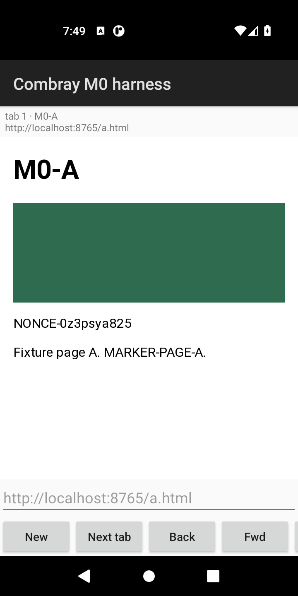
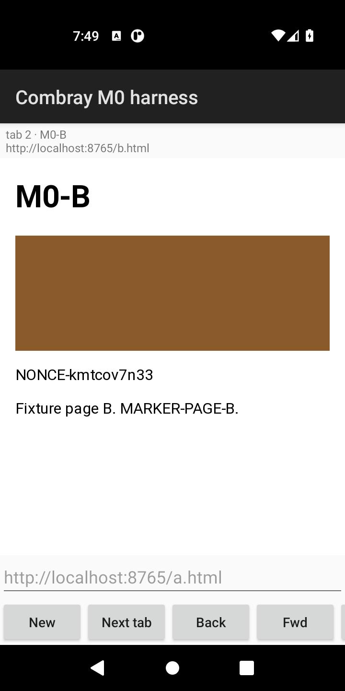
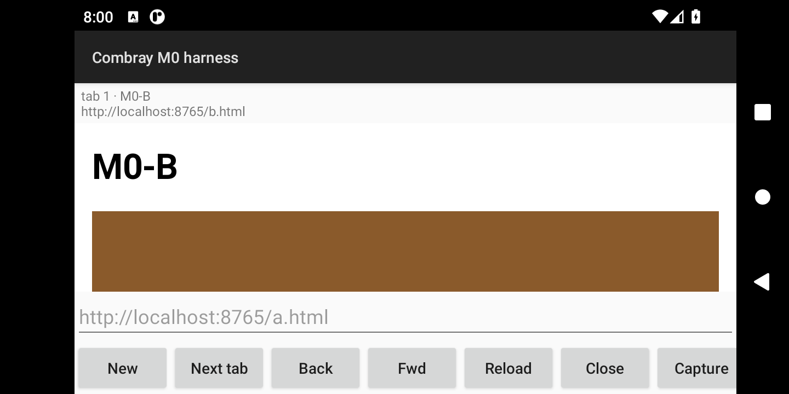
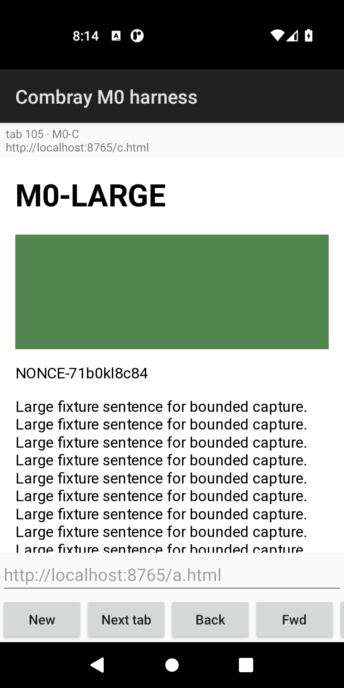
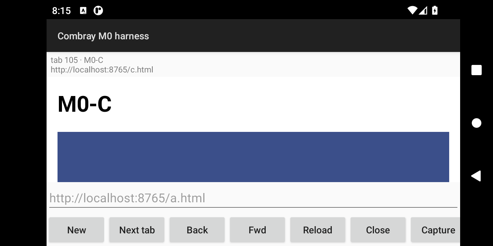

# M0 engine spike: Servo on Android

**Date:** 18 October 2026. **Scope:** milestone M0 of the [implementation plan](IMPLEMENTATION_PLAN.md#m0--prove-servo-on-android). This report records what was built, how, and what ran on Android. Build commands are in [BUILDING.md](BUILDING.md).

The numbered M0 sections retain their original release-and-patch evidence. Current source maintenance is recorded in [Downstream engine maintenance](#downstream-engine-maintenance-23-october-2026).

## Summary

| Capability (M0) | Verdict | Evidence |
| --- | --- | --- |
| Servo builds and runs on Android | **Go** (x86_64 emulator). ARM64: builds and packages; **not run** (no device) | Upstream servoshell passed mach's smoke procedure (`scripts/m0/smoke-upstream.sh`, [log](engine-spike/upstream-smoke-logcat.txt)); the harness ran every check in section 5 except text selection |
| Two independent views: switching, navigation, back/forward, close | **Go, one open defect** | All view checks pass; a reproducible stale frame appears when other views load or close while a large page is visible ([section 6](#6-open-defect-stale-frame)) |
| Input: touch, scroll, keys, IME | **Go** for tap, scroll, keys, IME commit; selection and pinch zoom not run | Section 5 |
| Surface lifecycle | **Go** | Resize, Home and return, rotation (Activity and surface recreated) keep tabs and documents |
| Bounded, attributed text capture | **Go** | Document-guarded capture never attributed text to the wrong document in any check, including navigation and close during capture and same-URL reloads |
| Profile persistence | **Blocked for process death** in M0; addressed after M0 by patch 0004 ([section 13](#13-after-m0-engine-changes-for-the-app)) | Cookies survive a clean engine shutdown but not a killed process; localStorage survives both |
| Script interruption | **Not available** in Servo v0.6.0 | Deadlines abandon results; the script keeps running |

The engine gate in the plan is met on the emulator: independent views and correctly identified capture pass on real Servo. Two problems must be solved or accepted before M1 relies on them: the stale frame and cookie loss on process death.

## 1. Environment

| Item | Value |
| --- | --- |
| Build host | Linux x86_64 container (Debian 12, kernel 7.0), 16 cores, 125 GiB RAM, shared with other workloads (load average 4–38 during the work) |
| Device | Android Emulator 37.1.11, AVD `combray-m0-api30-x86_64`: system image `android-30;default;x86_64` r10 (Android 11, API 30), 6 vCPUs, 6 GiB RAM, 720×1440 at 320 dpi |
| Acceleration | **None.** `/dev/kvm` is absent, so the emulator ran under software CPU emulation (`-accel off`). Boot took 7.6–17.5 minutes |
| Graphics | `-gpu swiftshader_indirect`: `OpenGL ES 3.0 SwiftShader 4.0.0.1`, EGL 1.4 |
| ABI | Runtime checks: x86_64 only. The arm64-v8a harness also builds (134 MB APK, AArch64 library with all 18 JNI exports) but was never run: no arm64 device or emulator was available |
| Toolchain | Rust 1.97.1, NDK r29 (29.0.14206865), SDK platform 37 and build-tools 36.0.0, JDK 21.0.12, Gradle 9.5.1, AGP 9.2.1; host C/C++ through zig 0.17 `cc` |
| Builds (SHA-256) | Upstream servoshell `servoapp.apk` x86_64 release: `552f76cb7def59914bd09287d7b59ca6a71117627a57e9671fab7eb9dd5876ae`; harness x86_64 (final run): `a0280b667f82c8047bfa3abec4472b348f6cdbb45a59b47b6cc0d66e8507bae7`; harness arm64-v8a (same sources): `854feff276acec6e1d9105bebcb85125baa3c1ac167c68ce90e1b050cd6e4640`. Debug-signed local builds; hashes identify them in this report only |

Software emulation is slow and timing-sensitive: Android's own framework timed out and restarted `system_server` twice while a 160 MB APK installed under heavy host load. Absolute timings below are from this environment and say nothing about phone performance.

## 2. Servo selection and integration decision

**M0 input:** Servo **v0.6.0** (git `c78d2c206f80a1c8b67eefa97f773bba513205d3`, release of 29 September 2026), built from `servo-v0.6.0-src-vendored.tar.gz` (SHA-256 `1d828f9956fcb0fccfd5af02e4c75bfb948344f04ba7af1765faff78d4aec0e6`) with three small patches. The current downstream pin is in [BUILDING.md](BUILDING.md#pinned-inputs).

- **Why v0.6.0:** it is the base of Servo's current long-term-support line (SpiderMonkey ESR 153); the LTS policy covers the `servo` library crate, which is what Combray embeds, and not servoshell. v0.7.0 (5 October) is newer but will be superseded monthly. Moving to a later 0.6.x LTS update means re-applying those patches.
- **Why not upstream's Android shell:** servoshell's JNI layer drives one active WebView at a time, reports no tab or document identity, and has no JavaScript evaluation entry point (source inspection, confirmed by the research verification). Extending it would mean carrying a fork of a demo shell outside LTS scope.
- **Chosen arrangement:** Combray's own Rust `cdylib` (`native/`) depends on `components/servo` from the pinned tree by path, uses servoshell's CI-tested Cargo feature set, and owns its JNI surface. A Kotlin harness (`spike/android/`) drives it. Servo itself is unmodified except for:
  - `0001` (build only): the release tarball's `vendor/` directory cannot build the mozjs glue crates, because their build scripts run `cbindgen` → `cargo metadata` against each crate's own `Cargo.lock` (`encoding_rs` 0.8.41 is not vendored). The patch drops the vendor redirection; Cargo then downloads the same locked versions from crates.io and checks their checksums.
  - `0002` (embedder API): document identity and a crash fix, described in [section 4](#4-servo-patch-0002-document-identity).
  - `0003` (diagnostics): log WebRender render errors instead of discarding them.

`native/Cargo.lock` starts from Servo's release lockfile, so every shared dependency stays at the release's versions.

## 3. Engine bridge design

```text
 Kotlin (any thread)                  engine thread (owns Servo, all WebViews, GL context)
 ───────────────────                  ──────────────────────────────────────────────────────
 NativeEngine.createTab(tab, url) ─┐   loop:
 navigate / select / close / input ├─▶   handle queued Commands
 capture(tab, document, id, …)     │     Servo::spin_event_loop()
 surfaceCreated (queued)           │     drain delegate queue → attribute → EngineEvent
 surfaceDestroyed (waits)          ┘     finish / expire captures
 EngineListener.onEngineEvent(json) ◀─   paint selected view, present
       (tab, generation, document)
```

- **Ownership:** `Servo`, `WebView` and the rendering context are `Rc`-based and stay on one engine thread. JNI calls only enqueue commands. Servo's event-loop waker is another sender on the same channel. Delegates copy each notification into a queue; the engine processes the queue after the spin, so no callback re-enters Servo.
- **Views:** one `WindowRenderingContext` bound to the visible `SurfaceView`; every tab is a separate `WebViewBuilder::build()` (a new constellation browsing context, not a cloned handle). Selecting shows and focuses one view and hides the others; only the selected view is painted. Hidden views keep running (measured in the results).
- **Identity:** events carry the application's tab ID, an engine-wide **generation** per native view (recreating a tab yields a new generation; events from an older generation are dropped), and the **document ID** (Servo's top-level pipeline ID). A new document ID means a new document even at the same URL. Reports from a document that was replaced are marked `stale`; reports that overtake their document's commit (Servo delivers them on a different channel) are held until the commit.
- **Surface lifecycle:** `surfaceDestroyed` first advances a surface epoch (painting stops at once), then waits for the engine to call `take_window()` and release its `ANativeWindow` reference. A new surface is bound with `set_window()`; Servo, tabs and documents survive.
- **Panics:** a panic inside a surface operation (Servo and surfman `expect` on some surface errors) becomes an error and the engine continues. Any other panic on the engine thread aborts the process, so Android reports a crash and the app restarts with session recovery, rather than leaving a silently dead engine. Panics on Servo's own threads, and those Servo marks as handled, are left to Servo.
- **Capture:** the engine asks Servo to run a bounded extraction script **in a named document**. Servo refuses if that document is no longer active. After the result returns, the engine re-checks that the document is still the tab's current one; otherwise the text is discarded (`stale_document`). The page-reported URL is only corroboration. Text is cut to 256 KiB of UTF-8 in the page and again natively, on a character boundary; title 4 KiB, URL 8 KiB; at most 50 000 nodes are visited.

## 4. Servo patch 0002: document identity

Source inspection of v0.6.0 (research verified by a second model, about 30 claims checked) showed that an embedder cannot attribute content to a document:

- `WebView::evaluate_javascript` runs in whatever document is active when the constellation handles the request. The result does not say which document produced it.
- No delegate notification carries a document identity. Title, load-status and status reports from an old document can still reach the embedder after a new document is active. Script-to-embedder messages bypass the constellation, so their order relative to history changes is not guaranteed.
- `GlobalScope::evaluate_js_on_global` asserts `can_run_script()`. A navigation between routing and execution (or, for WebDriver and user scripts, an iframe deactivation or window close) makes the script thread panic, which closes every WebView on that script thread.

Patch 0002 (131 added and 19 removed lines in 12 files; additive for existing embedders):

| Change | Purpose |
| --- | --- |
| `pub use servo_base::id::PipelineId`; `WebView::active_document_id()` set from each history change | Embedders learn the current top-level document, including after same-URL reloads |
| `PipelineId` in `HistoryChanged`, `NotifyLoadStatusChanged`, `ChangePageTitle` | Each report names its document |
| `WebViewDelegate::notify_document_load_status_changed` / `notify_document_title_changed` (default no-op) | Every report, with its document, without deduplication |
| `WebView::evaluate_javascript_in_document(document, …)`: constellation refuses with `DocumentNotFound` unless `document` is active | A result can only come from the named document |
| `evaluate_js_on_global` returns `DocumentNotFound` instead of asserting when script cannot run | Removes the crash for every caller: embedder evaluation, WebDriver `ExecuteScript`, user scripts |

Patch 0003 logs WebRender render errors, which `Painter::render` discarded (an upstream TODO); it was added to diagnose a stale-frame problem (section 6). These changes stay downstream. The owner prohibits upstream contributions and contact.

## 5. Checks and results

All checks ran against real Servo in the harness on the emulator described in section 1, with synthetic pages from `spike/fixtures/server.py` (no personal data, no live services). `scripts/m0/run-checks.sh` runs the in-app `core` scenario, then drives lifecycle phases from the host, then the stale-frame reproduction. The results below are from the final run (run9, 18 October 2026, 19:48–20:15 UTC) on the final sources; per-phase reports, a summary, device details and screenshots are in [engine-spike/](engine-spike/).

<!-- CHECK-TABLE-START -->
| Phase | Check | What it establishes | Result |
| --- | --- | --- | --- |
| core | `views-two-independent-webviews` | Two tabs are distinct core WebViews with their own documents and generations | passed |
| core | `engine-renders-on-android` | Servo paints the selected tab into the Android surface (pixels match the page) | passed |
| core | `views-switching` | Selecting a tab shows it (surface pixels match its page); no paint events for hidden tabs (by design) | passed |
| core | `views-independent-navigation` | Navigating one tab leaves the other's document and URL unchanged; new page on screen | passed |
| core | `views-back-forward` | Back and forward in one tab return cached documents without touching the other tab | passed |
| core | `views-same-url-tabs-independent` | Same URL in two tabs: separate JS globals, nonces and capture attribution | passed |
| core | `memory-baseline` | Process PSS with two and ten small tabs (measurement) | passed |
| core | `navigation-taxonomy` | Fragment, pushState, replaceState and failed load produce the expected events; embedder fragment load is recorded | passed |
| core | `input-touch-tap` | A touch tap clicks a page button | passed |
| core | `input-keys-and-ime-visibility` | Tapping a field requests the IME; key events type into it | passed |
| core | `input-ime-commit-unicode` | IME commit inserts multibyte text (é😀中) | passed |
| core | `input-touch-scroll` | A touch swipe scrolls the page | passed |
| core | `input-selection` | Text selection | not run |
| core | `surface-resize` | Resizing the surface resizes the page viewport and back | passed |
| core | `capture-js-rendered-text` | Capture includes text inserted by script after load | passed |
| core | `capture-redirect-attribution` | A redirect commits once, with the final URL; capture is attributed to it | passed |
| core | `capture-same-url-reload` | Reload creates a new document; captures naming the old one are refused by Servo | passed |
| core | `capture-navigation-during-capture` | A capture racing a cross-site navigation runs in the old document and is discarded as stale (not run if no race occurs) | passed |
| core | `capture-close-during-capture` | Closing a tab during capture settles it as tab_closed at close time, with no text | passed |
| core | `capture-stale-title-ignored` | An old page's late title reports are marked stale; the new page keeps its title | passed |
| core | `capture-shadow-dom` | Open shadow DOM and slotted text are captured; hidden shadow text is not | passed |
| core | `capture-bounds-multibyte` | A 1,000-byte cap cuts multibyte text on a character boundary; hash matches | passed |
| core | `capture-bounds-large` | A 1.6 MB page is cut to the 256 KiB budget | passed |
| core | `capture-empty-document` | An empty body reports empty, not captured | passed |
| core | `capture-hostile-page` | Pages that break built-ins, return huge strings or claim huge child lists yield an error or bounded text, never other documents' text | passed |
| core | `capture-timeout-abandons-result` | A deadline reports timed_out once; the late result is ignored | passed |
| core | `hidden-view-behaviour` | Timer rate in a hidden tab, normal and throttled (measurement) | passed |
| core | `views-close-one-keeps-other` | Closing one tab leaves the other working and on screen; no events from the closed tab | passed |
| core | `display-follows-navigation` | After each scripted navigation of the selected tab that changes the swatch color, the surface shows the new page | **failed** |
| resume-check | `surface-background-foreground` | Home and return: surface released and rebound; tab and document unchanged; pixels show the page | passed |
| rotation-check | `surface-rotation-recreation` | Rotation recreates Activity and surface; tab and document unchanged; landscape viewport | passed |
| persist-set-clean | `persist-set` | Sets a cookie (echoed by the server) and a localStorage value (setup) | passed |
| shutdown | `engine-clean-shutdown` | Servo shuts down cleanly and writes its profile | passed |
| persist-check-clean-exit | `session-last-url-recovery-clean-exit` | After a clean exit, open tabs are restored at the URL committed last before it | passed |
| persist-check-clean-exit | `profile-cookie-persists-clean-exit` | A cookie set before a clean shutdown is sent after restart | passed |
| persist-check-clean-exit | `profile-localstorage-persists-clean-exit` | localStorage set before a clean shutdown is present after restart | passed |
| persist-set-kill | `persist-set` | Sets a cookie (echoed by the server) and a localStorage value (setup) | passed |
| persist-check-after-kill | `session-last-url-recovery-after-kill` | After the process is killed, open tabs are restored at the URL committed last before it | passed |
| persist-check-after-kill | `profile-cookie-persists-after-kill` | A cookie set before the process is killed is sent after restart | **failed** |
| persist-check-after-kill | `profile-localstorage-persists-after-kill` | localStorage set before the process is killed is present after restart | passed |
| diag-tail2-stale-frame-variants | `dwell-only` | Stale-frame variant: keep a large page visible for 30 s, then navigate | passed |
| diag-tail2-stale-frame-variants | `dwell-timed-out-capture` | Stale-frame variant: timed-out capture on the large page, then navigate | passed |
| diag-tail2-stale-frame-variants | `dwell-reselect` | Stale-frame variant: reselect the tab showing the large page, then navigate | passed |
| diag-tail2-stale-frame-variants | `dwell-throttled-timer-tab-closed` | Stale-frame variant: hidden timer tab created, throttled and closed, then navigate | passed |
| diag-tail2-stale-frame-variants | `dwell-eight-hidden-tabs` | Stale-frame reproduction: create and close eight hidden tabs while a large page is shown, then navigate | **failed** |
| screen-check-stale-frame-after-home | `screen-matches-selected-tab-after-home` | After the reproduction, Home and return: does the surface show the tab's page? | **failed** |
| screen-check-stale-frame-after-rotation | `screen-matches-selected-tab-after-rotation` | After the reproduction, rotation: does the surface show the tab's page? | passed |

Totals: 42 passed, 4 failed, 1 not run.
<!-- CHECK-TABLE-END -->

| Tab 1 selected | Tab 2 selected | After rotation |
| --- | --- | --- |
|  |  |  |

What the checks establish, beyond pass or fail:

- **Independence.** Each tab is a separate `WebViewBuilder::build()`: distinct `WebViewId`s, documents and generations. With the same URL in two tabs, a global set in one tab is `undefined` in the other, and simultaneous captures return each tab's own per-load nonce.
- **Switching paints the right tab.** After selection the harness reads the surface back (`PixelCopy`) and compares it with the selected page's swatch color. Hidden tabs produce no paint events, by design: only the selected view is painted. The same pixel comparison follows each scripted navigation of the selected tab whose swatch color differs from what was on screen (`display-follows-navigation`) and the return from Home.
- **Capture identity.** Across a same-URL reload the document ID changes. A capture naming the old document is refused by Servo itself (`document_not_found`, tested with the engine's local shortcut disabled). An unguarded evaluation in the same situation silently returns the new document's nonce, which is exactly the misattribution the patch prevents. A capture racing a cross-site navigation ran in the old document and was discarded as `stale_document`. Closing a tab settles its pending capture as `tab_closed`. Late results after a deadline are reported and dropped.
- **Stale titles.** The old page sets `document.title` in `pagehide`/`unload`. Its reports arrive after the new document committed and are attributed `stale`. Upstream's unattributed `notify_page_title_changed` received the stale title too, and names no document, so only arrival order decides which title an embedder relying on it shows. In run 9 the stale title arrived last (`null`, empty, `M0-C`, `M0-STALE-FROM-A`), leaving the old page's title on the new page; in run 8 it arrived before `M0-C`.
- **Bounds.** A 1.6 MB page is cut to 261,996 bytes at a character boundary (`truncated_in_page`); a page whose text getter returns 5 MiB is cut to 262,144 bytes; a 1,000-byte cap on multibyte text yields 998 valid UTF-8 bytes; an empty body reports `empty`; a page that breaks `getComputedStyle` yields `script_error` rather than partial text; a page that claims a billion children per node yields `script_error` within 0.3 s instead of exhausting memory (the traversal never queues more children than its node budget can visit). Open shadow roots and slots are captured; `hidden` content inside them is not.

## 6. Open defect: stale frame

**Symptom.** After certain activity in *other* views while the visible view shows a long page (`large.html`, 1.6 MB of text), later navigations of the visible view reach Servo but not the screen. History, titles, load events and captures all report the new document; the surface keeps showing the old page. In the minimal reproduction the screen does not recover after a second navigation, nor after Home and return, which releases and rebinds the surface at the same size. It does recover after rotation, which recreates the Activity and a differently sized surface (runs 7 to 9).

**Reproduction** (`diag-tail2:dwell-eight-hidden-tabs`, failing in runs 5 to 9): open a tab, select it, navigate to `large.html`; create eight hidden tabs on a small page and close them; navigate the visible tab to `b.html`. The variants that only dwell on the page, reselect it, or run a timed-out capture pass. In the full scenario, a hidden tab navigating, being throttled and closing while `large.html` was visible also triggered it; there the screen caught up later (after 15–45 seconds in runs 5 and 6), which is why `views-close-one-keeps-other` passes while `display-follows-navigation` fails on the same navigation.

| After Home and return | After rotation |
| --- | --- |
|  |  |

**What is known.**

- Temporary logging in `components/paint/painter.rs` (not in the patch set) showed the paint layer's bookkeeping is correct: after the navigation, the root display list contains exactly one visible WebView whose root pipeline is the new document.
- WebRender reported no render error (patch 0003 logs them).
- The problem needs the large page; the same operations with small pages are fine.
- It was seen only with SwiftShader under software emulation. No GPU device was available.

**Next steps.** Run the reproduction on an arm64 phone. Test whether a resize alone clears it, since rotation does and a same-size surface rebind does not; that would also be a cheap workaround. If it persists, capture WebRender state (`WebView::capture_webrender`, debug flags) and keep the reproduction downstream. Candidate workarounds to evaluate, not yet tested: one `OffscreenRenderingContext` per tab composited into the window context, or rebuilding the shared painter after view churn.

## 7. Navigation event taxonomy

Observed through the patched delegate on the device (`navigation-taxonomy`, other checks) and from source inspection where noted:

| Navigation | Engine event | Document ID |
| --- | --- | --- |
| Embedder `load` of a new URL | `navigation_requested` (with the caller's request ID), then `document_committed` | New |
| Redirect | One `document_committed` with the final URL | New |
| Same-URL reload | `document_committed`, same URL | New |
| Back/forward to a cached document | `document_committed` | The **earlier** ID again (bfcache) |
| Page-initiated fragment change | `same_document_navigation` | Unchanged |
| `history.pushState` | `same_document_navigation` | Unchanged |
| `history.replaceState`, same URL | `history_updated` | Unchanged |
| Embedder `load` of a URL differing only in its fragment | `document_committed` | **New**: the embedder path reloads instead of scrolling |
| Network failure (connection refused) | `document_committed` for Servo's error page ("Error loading page"), load `complete` | New; indistinguishable from success except by title (source: no load-failure notification exists) |
| Load status, title | Tagged with the reporting document; `stale` after replacement; held until commit when they overtake it | Not applicable |

Requests and commits are separate events. Servo does not tie a commit to the embedder's request, so Combray cannot correlate them beyond ordering.

## 8. Measurements

Emulator under software emulation; useful for relative comparisons only.

| Measurement | Value |
| --- | --- |
| Process PSS, two tabs with small pages | 141 MiB |
| Process PSS, ten tabs with small pages | 156 MiB |
| Process PSS after the full `core` scenario (about 15 cached documents, two 1.6 MB pages) | 840 MiB in the final run, mostly anonymous memory Android cannot attribute (jemalloc, SpiderMonkey) |
| Hidden tab, page timer at 10 Hz | 9.4 ticks per second; with `set_throttled(true)`: 1 per second |
| Clean engine shutdown (persists cookies) | 80 s in the final run; 15–157 s in earlier runs on this host (logs not kept) |
| Capture of a 1.6 MB page | 1.1–6.0 s; 20,000-node page 10–20 s (runs 8 and 9, under varying host load) |
| Emulator boot / harness APK install | 7.6–17.5 min / 1–7 min (142 MB APK, 131 MB native library), measured during this work (logs not kept) |
| Upstream servoshell APK / library | 160 MB / 180 MB unstripped (x86_64 release) |

## 9. Security and process model

- **One process.** v0.6.0 runs everything in the app process on Android (`Opts::multiprocess` defaults to false, and servoshell's Android port does not support content processes). There is no content sandbox beyond Android's app sandbox. Web content shares the address space with the native bridge.
- **No page-to-native bridge.** Page scripts cannot call the engine; the only JavaScript Combray runs is the capture script and the harness's test evaluations, both issued natively.
- **Hostile pages.** A page can redefine any built-in the capture script uses. That changes only its own reported text; it cannot attach text to another document, because document identity comes from the engine. It can make the script run forever: there is no interruption (section 10).
- **Permissions** are denied; popups (`request_create_new`) are refused; dialogs, select and file pickers fall back to Servo's default response. (The app presents dialogs, select and file pickers since M4; see section 13.)
- The harness's network security configuration is a statement of intent only: Servo has its own network stack and does not consult Android's policy.

## 10. Limitations and checks not run

- **Not run:** physical devices, arm64 at runtime, real GPUs, Android versions other than 11, text selection, pinch zoom, external `VIEW` intents, downloads, permissions UI, Kagi or any live site, login flows, TLS sites (fixtures are plain HTTP on loopback).
- **Script interruption:** Servo's interrupt callback only serves shutdown. A capture deadline abandons the result; the page script keeps running and can hang its script thread and every tab sharing it.
- **Cookies** are written only on clean shutdown (`components/net/resource_thread.rs`, `CoreResourceMsg::Exit`). Android may kill a backgrounded app without warning, so logins set since the last clean shutdown are lost, as the after-kill check shows. A clean shutdown took 15–157 seconds here. M1 needs an upstream change (flush the cookie jar on change or on request) or must accept the loss. *After M0:* patch 0004 adds the write on request ([section 13](#13-after-m0-engine-changes-for-the-app)); cookies changed in the last five minutes of foreground use can still be lost to a kill.
- **Session recovery** is URL-level only: after a kill the harness restores each tab's last committed URL. Back/forward lists, scroll positions and form state are lost; Servo has no session export API.
- **Capture eligibility** filters `hidden`, `aria-hidden`, `inert`, editable content, form controls, `display: none`, `visibility: hidden/collapse` and `content-visibility: hidden`. It still includes text hidden by zero size, clipping, opacity or off-screen positioning, and it cannot read closed shadow roots or cross-origin frames.
- **The harness is not the product.** It has no bottom chrome, persistence model, settings or integrations; its manual UI exists for debugging. The application ID `ch.lkmc.combray.enginespike` is for the harness only.
- **Build features** mirror servoshell's (including WebGPU, WebXR, Bluetooth and test bindings) because that combination is CI-tested upstream; trimming them is an M1 decision.

## 11. Reproduce

```sh
scripts/m0/fetch-servo.sh
scripts/m0/build-harness.sh
scripts/m0/emulator.sh
scripts/m0/run-checks.sh emulator-5560
```

[BUILDING.md](BUILDING.md) lists prerequisites and the problems met. Single scenarios run with `scripts/m0/run-checks.sh <serial> core` or `diag-tail2:dwell-eight-hidden-tabs`.

## 12. Next steps

1. Run the harness on an arm64 phone (the owner's device if possible) and record the same checks there.
2. Narrow the stale-frame defect on a real GPU; keep the reproduction downstream.
3. Investigate embedder-script interruption downstream. Cookie persistence is addressed by the change formerly carried as patch 0004.
4. Maintain document identity, the crash fix and render diagnostics downstream. Never offer them upstream.
5. Done: M1 started from `native/` and kept the engine thread, identity model and capture path ([section 13](#13-after-m0-engine-changes-for-the-app)).
6. Keep the profile-persistence change and cookie-loss reproduction downstream.

## 13. After M0: engine changes for the app

The app (M1–M3) uses the same bridge, thread model and capture path. Changes since the M0 report:

| Change | Why | Where |
| --- | --- | --- |
| Patch 0004: `CoreResourceMsg::PersistState` and `SiteDataManager::persist_to_disk` write the cookie jar, HSTS list and HTTP auth cache on request; profile files are written to a temporary file and renamed, and a failed write is logged instead of panicking | Servo wrote cookies only at a clean exit, which Android rarely allows, so logins were lost (section 10). A kill during an in-place write could truncate a profile file | `native/servo/patches/0004-*` (4 files, 64 insertions, 20 deletions) |
| Servo preference `dom_intersection_observer_enabled` on | Off by default in Servo 0.6.0 (servoshell enables it only with its experimental features). Next.js sites call it on start-up; without it anthropic.com's script failed with `IntersectionObserver is not defined` and the site replaced the page with its error screen. Servo's implementation has open TODOs for clipping and visibility | `native/src/engine.rs`; `BrowsingTest#pagesCanObserveWhatIsOnScreen` |
| Servo preferences `dom_fontface_enabled`, `dom_indexeddb_enabled` and `dom_adoptedstylesheet_enabled` on | Experimental and off by default in Servo 0.7 (servoshell enables them only with its experimental features). Pages that construct `FontFace`, call `document.fonts.add` or `load`, assign `adoptedStyleSheets` or open IndexedDB unconditionally stopped with a `TypeError`. IndexedDB data is stored in the profile directory. `dom_web_animations_enabled` stays off: Servo 0.7's `Animation` still lacks `play`, `cancel` and `finished`, and with it on `animations.js` would step aside for that stub | `native/src/engine.rs`; `BrowsingTest#pagesCanUseTheEnabledExperimentalApis` |
| Every view runs `animations.js` before a document's own scripts (Servo `UserContentManager`). It adds stubs for `Element.prototype.animate`, `Element.prototype.getAnimations` and `document.getAnimations`, whose first use installs web-animations-js 2.3.2 (vendored next-lite build, with `finished` promises and `effect`) and adds the `effect.getComputedTiming()` it lacks | Servo 0.6.0 has no `Element.animate()`; its Web Animations interfaces behind `dom_web_animations_enabled` are stubs without `play`, `pause`, `cancel` or `finished`. docs.mistral.ai's marquee calls it unconditionally, so the site showed its error screen. The polyfill wraps `requestAnimationFrame`, `getComputedStyle` and animated elements' `style`, hence the lazy install; it steps aside for a complete native implementation. The constructors (`Animation`, `KeyframeEffect`) and `document.timeline` still appear only after that first use. Known polyfill bug: `pause()` then `play()` within one frame leaves a later `cancel()` without effect | `native/src/animations.js`, `native/src/animations.rs`, `native/src/engine.rs`; `BrowsingTest#pagesCanAnimateElements` |
| `persistProfile` command and `profile_persisted {ok}` event | The app persists when it leaves the foreground and every five minutes while in use; each write briefly holds the engine thread | `native/src/engine.rs`, `CombrayApplication.kt` |
| `captureArticle(tab, document, id, maxBytes, timeoutMs)` | Reader view: the capture path with `reader.js` and Readability.js instead of the text script; the result's text is the article as JSON. A separate entry point keeps `capture`'s JNI signature, which the M0 harness also binds | `native/src/reader.js`, `native/src/capture.rs`, `native/src/jni_api.rs` |
| `selectNone` command | The app's home screen shows no page: no view is painted under it | `native/src/engine.rs` |
| Page navigations decided by scheme; `external_link {url}` event | Servo allowed every page navigation: a tapped `mailto:` or `tel:` link replaced the page with its error page, and pages could open `file:` URLs. Web schemes load; app links are denied in Servo and handed to Android, only within 5 s of the user's tap or key press in the visible tab. A tap is one pointer that stayed within 10 dp of where it went down on both axes, Servo's own scroll threshold; the end of a scroll, fling or pinch does not count. A window a page opened for such a link (`target=_blank`, `window.open('tel:...')`) that has shown nothing but its initial `about:blank` is closed with `tab_closed`, then the link is reported for its opener; it would otherwise stay a blank tab. Other schemes are denied and logged by scheme only. The app launches only these schemes, drops an `intent:` link's flags, component and selector, and refuses one naming Combray's own package | `native/src/navigation.rs`, `native/src/activation.rs`, `native/src/engine.rs` (`page_navigation`), `ExternalLinks.kt` |
| Windows only after a tap; `popup_blocked` event | Servo 0.6.0 opens every `window.open()` and `target=_blank` window with or without a user gesture, and each new focused tab could open the next. The engine opens a page's window only within 5 s of the user's tap or key press in the visible tab, one window per tap, and reports refusals; the app says so once per document. Opening the window uses the tap up in the opener, so the window's first navigation (only that one, within the same 5 s) may still use it: a tapped `target=_blank` app link still opens its app | `native/src/engine.rs` (`open_page_tab`, `page_navigation`), `native/src/activation.rs` (`OpeningTap`), `BrowserCoordinator.kt` |
| `setDarkAppearance` command | Servo starts every view with a light theme and changes it only on `WebView::notify_theme_change`; without it `prefers-color-scheme: dark` never matched. The engine applies the app's light or dark theme to every view as it is created and to all views on a change; documents loaded later inherit it | `native/src/engine.rs`, `BrowserCoordinator.setAppearance`, `BrowserScreen.kt` |
| Capture time budget and touch deferral | Capture held the page's script thread for 1-6 s on a 1.6 MB page (section 8) right after load, when the user starts scrolling. The walk now stops after 400 ms for the page on screen (for hidden ones, the result deadline less 0.5 s, 2.5 s at most; none left reads nothing) and returns what it read, marked truncated (`time_budget_exhausted`); a capture of the page on screen waits while a finger is down and for 1.5 s after (10 s at most; a cancel ends the gesture, and a finger silent for 10 s counts as lifted); computed styles are read once per element. Limits: the clock is the page's, so a page faking a slow one removes the time bound (one reading NaN stops the walk), and work within one node is not clocked; the node budget still applies. Interruption in Servo (section 10) remains the fix | `native/src/capture.js`, `native/src/capture.rs`, `native/src/engine.rs` |
| `tab_opened {view, opener}` for `request_create_new`, only from the focused view | Page-opened windows (`target=_blank`, `window.open`) become focused tabs instead of being refused; background tabs cannot open windows | `native/src/delegate.rs`, `engine.rs` |
| `tab_closed` for `window.close()` (`notify_closed`) | A page closing its own window closes the logical tab like a user close | `native/src/delegate.rs` |
| `ime_shown {kind}` from Servo's `InputMethodType` | The keyboard matches the field: password fields disable suggestions and personalized learning | `native/src/delegate.rs`, `EngineSurfaceView.kt` |
| `ime_shown {document, show_keyboard}`, `imeDismissed()` and a tap check for focused fields | Servo allows the keyboard only once the page has had user activation (`InputMethodControl::allow_virtual_keyboard`), asks for it only when a field gains focus and hides it only on blur. A field a page focused on load covered the page with the keyboard; a keyboard the user closed could not be reopened by tapping the still-focused field; it stayed up after a form sent with Enter, and a hidden tab's field could take the keyboard over. Now the keyboard opens only when Servo allows it. A one-finger tap (Servo's 10 dp pan threshold; a gesture that had a second finger is no tap until every finger lifts) on the selected tab's focused field without a keyboard opens it: the engine asks the page with `elementFromPoint` in the current document, and the answer counts only for the field it asked about. When the user closes the keyboard, the app sends `ImeEvent::Dismissed`, as servoshell does, so the field gives up focus and the next tap focuses it again. The surface reads the keyboard's visibility from the window's insets on each window layout or inset dispatch and counts a closing it did not ask for as the user's, also when the keyboard was already on screen when the field asked for it; it read Compose's insets before, which are read only on a frame, and in the first device run the user's closing never reached the page (likely cause: under the test's manual clock the keyboard opened and closed between two frames). A refused `showSoftInput` counts as a dismissal. Each tab keeps its own field; a new document drops it, and `ime_hidden` comes only from the selected tab | `native/src/keyboard.rs`, `engine.rs`, `delegate.rs`, `EngineSurfaceView.kt`, `PageKeyboardTracker.kt`, `BrowserCoordinator.kt` |
| Log filter: Servo `error` only, Combray `info` | Servo's warnings often name page URLs | `native/src/jni_api.rs` |
| `control_shown {control, kind}` / `control_hidden` and `respondToControl(control, json)` for `<select>` pickers, `alert`/`confirm`/`prompt` and `<input type=file>` | The engine dropped them, so Servo answered with defaults: dropdowns could not change, `confirm()` returned false and uploads were impossible. The engine keeps each Servo handle until the app answers or the page withdraws it; page strings are bounded (4,000 characters, 2,000 options) | `native/src/controls.rs`, `engine.rs` |
| `contextClick(x, y)` and `link_menu {link, image}` | A long-press becomes a secondary click, so Servo fires `contextmenu` and, unless the page cancels it, offers its context menu; the app acts on the link or image address itself (open in a new tab through the address policy, copy, share) and dismisses Servo's menu. Menus without a link or image (editing actions) are dropped: the app has no clipboard bridge. The hold is timed from when the app handled the press, not from the event's timestamp (as Android's `GestureDetector` does), so after a main-thread stall a tap's queued lift still cancels it | `native/src/engine.rs`, `EngineSurfaceView.kt` |
| `sign_in {origin, proxy}` and `credentials` answers | Servo's `request_authentication` (navigations only) becomes a page control naming the server's origin; the app's dialog answers with a username and password or cancels, and a dropped request loads the server's 401 page. Credentials are never stored by Combray; Servo keeps accepted ones for the session. Parse errors and `Debug` output leave out the password | `native/src/controls.rs`, `native/src/engine.rs`, `PageControlDialog.kt` |
| `screen_geometry` in `TabDelegate`: screen, available screen and window are the view's size, the window at the origin | Servo 0.6.0 answers 0 for `screen.width`, `screen.height`, `availWidth`, `availHeight`, `outerWidth` and `outerHeight` when the delegate gives no geometry (its documentation promises the rendering context's size, but the code returns zeros). Pages size images and layouts from these, and bot checks treat a 0×0 screen as headless. Like servoshell's Android port, the screen is the page area, not the whole display: it leaves out the status bar and Combray's bottom bar, and shrinks while the keyboard is open. Reporting the display itself would need its size from Android through JNI | `native/src/delegate.rs`; `BrowsingTest#pagesSeeAScreenAtLeastAsWideAsTheirWindow` |
| `load_web_resource` cancels loads whose fetch destination is `audio`, `video` or `track`, and `media_blocked {document, kind, url, referrer}` reports them per page; `engine_ready {user_agent}` | Combray's Servo has no media backend (Servo 0.7.0 offers GStreamer, which is not built for Android), so `servo_media_dummy` accepts media data and never plays it. Servo stops a media fetch only when the player has enough data, which the dummy never reports, so every `<video>` and `<audio>` file downloaded in full; by Servo's source the element also held back the page's load event. A cancelled load is a network error: the element fires `error` and the page can show its fallback. Script fetches (`fetch()`, XHR) have the empty destination and continue. The decision is synchronous in the delegate (it only answers on the fetch's channel); a load names its view but not its document, so the engine attributes it to the tab's committed document. For the app's player (VIDEO.md, slice C1) the report carries the fetch destination as `kind`, the load's `url` when it is http(s), without credentials and at most 8 KiB (never for `track`; else null), and the origin of the request's referrer when http(s) (else null; Servo applied the page's referrer policy before the delegate sees the load). A page is the committed document at its URL without the fragment: a new document, or a same-document move to another address, starts a new one. Per page the engine reports each of the 32 most recent URLs once and media without a reportable URL once; a token bucket per tab (burst 8, 1 a second), kept across a document's address changes and restarted when another document commits, drops reports beyond it, and a dropped report is not sent later. `engine_ready` adds `user_agent`, Servo's `Preferences::user_agent` read before Servo starts | `native/src/media.rs`, `delegate.rs`, `engine.rs`, `events.rs`; `BrowsingTest#mediaIsCancelledBeforeDownloadingAndThePageIsTold` |
| `control_shown {kind: "leave_page"}`, answered `accept` (Leave) or `dismiss` (Stay) | Servo's `request_unload` (a page's `beforeunload` asks to stay) was dropped, which Servo answers with leave, so unsaved form text was lost without a question. Servo does not check user activation, so the engine asks only where browsers do: on the selected tab, after a touch Up, key press or IME commit reached its current document; otherwise it allows at once. The page's script thread, shared with same-site tabs, blocks until the answer, so an unanswered question is answered Stay after 30 seconds (proposed default), as is one whose tab leaves the screen or whose answer does not fit; one whose tab closes or commits another document is dropped | `native/src/controls.rs`, `native/src/engine.rs`, `PageControlDialog.kt` |
| `setPageZoom(zoom)` for every view | More › Text size: only the display density reached Servo, so Android's font size never changed page text, and pinch zoom only magnifies. Servo 0.6.0's `WebView::set_page_zoom` changes the page's `devicePixelRatio` and lays it out again; Servo keeps it per view across navigations and clamps it to 10–1000%. The engine keeps one zoom, applies it to the open views and to each new view right after `build()` (Servo builds a view at 100%, so its first document may lay out once more), and refuses values that are not a zoom factor | `native/src/page_zoom.rs`, `engine.rs`, `jni_api.rs`; device check `TextSizeTest` (passed on #87's branch at `d4098c9`; not re-run after its paint fix or on the integrated tree) |
| `find(tab, generation, document, request, query, index)`, `clearFind(tab, generation, document)` and `find_result {document, request, status, count, index, capped}` | Find in page: Servo 0.6.0 has no embedder find API and no `window.find`. `find.js` runs in the document the app saw, through `evaluate_javascript_in_document`, and only while that view still shows it: a request for a replaced document is answered `stale_document` without running, so a page that committed before the app heard of it is neither selected nor scrolled, and clearing skips it. The script walks its rendered text nodes (at most 50 000, 999 matches and one second), selects one match with a DOM `Range` and scrolls its element to the middle of the view. The query enters as a JSON string literal, never as source. The page's realm runs it, so a page can see the query and misreport its own matches: the result is reduced to bounded integers natively, and one from a replaced document is reported as `stale_document`. Clearing restores the page's earlier selection unless the page changed it since | `native/src/find.js`, `native/src/find.rs`, `engine.rs` |
| `sign_in {origin, proxy}` and `credentials` answers | Servo's `request_authentication` (navigations only) becomes a page control naming the server's origin; the app's dialog answers with a username and password or cancels, and a dropped request loads the server's 401 page. Combray stores no credentials. Servo keeps a 401 answer only in the page's URL (next row), and a 407 (proxy) answer in its auth cache (limitations below). Parse errors and `Debug` output leave out the password | `native/src/controls.rs`, `native/src/engine.rs`, `PageControlDialog.kt` |
| Every URL the engine reports leaves out `user:password@`, except a link for another app (`external_link`), which is never `http(s)` and opens as the page wrote it: history events (`document_committed` and the rest), `navigation_requested`, `page_navigation_requested`, a capture's `content.url` and `observed_url`, `link_menu` addresses, and reader-view links. Before Servo starts, the engine deletes `auth_cache.json` (and patch 0004's `.tmp` copy) from the profile | After an HTTP sign-in, Servo 0.6.0 writes the username and password into the request URL (`http_loader.rs`, step 14.3) instead of an auth-cache entry, so the committed document, its history entries and its relative links carry them. The app stored that URL in Recent, showed it, shared it and reopened it after a restart. Servo's own URL keeps the credentials, so the page and its links stay signed in. Without the deletion, proxy sign-ins saved by an earlier run would be sent again without asking | `native/src/userinfo.rs`, `native/src/profile.rs`, `events.rs`, `controls.rs`, `reader.js`, `engine.rs`; `HostNames.withoutCredentials` before the app stores a URL; `PageControlsTest#aSignInFromTheDialogReachesTheServer` |

Evidence on the emulator (`scripts/check-app.sh`, [BUILDING.md](BUILDING.md#emulator-and-checks)): after the app went to the background, the cookie jar on disk contained a cookie set moments earlier (`ProcessDeathTest#prepare`, passed), and after a forced stop and relaunch Servo sent that cookie again (`ProcessDeathTest#verify`, passed in run `run9`).

Limitations found while building the app:

- **Servo error lines can contain page URLs.** The log filter keeps Servo's `error` level because engine failures must stay diagnosable; some of those lines name the page. Combray's own log lines carry no page text or addresses.
- **Screen density is read once.** The HiDPI factor passed to Servo at startup is not updated when the density changes in the same process (display size setting, moving between screens); pages then render at the old scale until the app restarts.
- **No audio or video.** Without a media backend nothing plays; the engine cancels media element and text-track loads instead of downloading them (table above), and the app says so on the page. A load names no document, and Servo delivers loads, document starts and commits on three channels taken in no fixed order, so a new document's first loads can arrive before its start and its commit. The engine holds a load that arrives after the app asked for a page (a new tab, an address, a reload) or after a new document reported its start, and before a commit, and gives it to the document that commits (`media::PendingMedia`; a request that commits nothing within 30 s, or a start within 5 s, gives its loads back to the committed page). The app also holds, while a page it asked for is pending, every report with a referrer, gives those from the new page's origin to that page when it commits, and gives them back to the page on screen when the wait ends without a commit. What stays wrong: a load that overtakes both the start and the commit of a page the page itself opened (a link), or a `pushState`, counts for the page before it, and a late one from the replaced document or the previous route counts for the new page. A page that sends more reports than the budget allows loses the rest, and a `pushState` route's report can be lost to an earlier route's flood. Media a page downloads by script is not cancelled and does not play either. A real backend (servo-media on Android's MediaCodec) would be new engine work.
- **Leave-page questions cover page navigations only.** Servo 0.6.0 runs `beforeunload` for navigations the page starts (links, forms, `location`), for reloads and for `window.close()`. The constellation loads embedder URLs (`LoadUrl`) and traverses history without it, so a typed address, a link from another app, Back/Forward and closing a tab still discard unsaved form text without asking. Covering them needs a Servo change.
- **A refused or handed-off link still stops the page's loading.** Servo's `navigate()` queues `abort_a_document_and_its_descendants` on the script thread before it asks the embedder (`components/script/navigation.rs`, step 24.4, lines 546-565 of the patched tree), and `NavigationRequest::deny()` does not undo it. The page stays on screen, but its in-flight fetches, EventSources and parser are aborted. If the link was tapped before the load event, the page never reports load complete: the address bar can keep showing it loading, and capture skips it. The fix needs a Servo patch: skip the abort for schemes the embedder will not load, as Chromium does for external protocols, or queue it only once the embedder allows the navigation.
- **The tap check ignores pinch-zoom panning.** Servo 0.6.0 exposes the pinch-zoom factor but not the zoomed area's offset, so on a pinch-zoomed page a tap on a field focused before the user touched the page can miss it (no keyboard; tapping elsewhere and then the field works) or count a nearby tap.
- **Profile writes block the engine thread** for the duration of three small file writes; the five-minute interval keeps that rare.
- **An HTTP sign-in lasts only on its page.** Servo 0.6.0 keeps a 401 answer in the document URL, which the app never sees, not in its auth cache. Links on the signed-in page inherit it; anything else asks again: the same address typed, opened from Recent, restored after a kill or opened from the link menu in a new tab. A script request that does not inherit the URL (`fetch(location.origin + …)`) gets the 401 without a prompt, because Servo asks only for navigations. The fix is a Servo patch that stores the answer as an auth-cache entry for its origin; it must ship together with the next item's patch change, or it would write 401 passwords to disk.
- **Proxy sign-ins reach the disk.** Servo stores the answer to a 407, which any server can send (Servo does not check that a proxy is configured), in its auth cache with the password in plain text, and sends it again to that origin as `Authorization` without asking. Patch 0004 writes the cache to `auth_cache.json` with the cookies (upstream wrote it only at a clean exit). The engine deletes the file before Servo starts, so a later run does not read the sign-in back, but the file stays on disk from the next profile write until then. Planned patch change: leave `auth_cache.json` out of `persist_state` in patch 0004, which also covers the exit write, so the auth cache lives only in memory. Not done here because it means preparing the Servo tree again.
- **Pages behind an HTTP sign-in can be captured.** Before the address lost its credentials, Combray skipped such pages for Hister and refused a Karakeep save as sensitive. Now they are treated like a page signed in with a cookie: captured only when Hister capture is on and the host is not excluded.
- **Emulator compositor.** After about 2.5 hours of headless running, the reference emulator's screenshots turned all black, the launcher included, while the app kept working. This was an emulator problem, not an engine one; `check-app.sh` now detects it before running checks.

### Reddit loading and fixed-layer scrolling (24 October 2026)

The owner reported a partially rendered Reddit feed that kept loading and
would not scroll. The screenshot's directional button shows that Combray
received the swipe. Loading does not disable input in `EngineSurfaceView`.
Reddit answered HTTP 403 from this host, including a mobile User-Agent;
the live feed and the cause of its unfinished load remain unverified.

A native regression confirmed a separate relevant defect: fixed
descendants are siblings of the viewport scroll node. When an empty fixed
scroll box cannot consume a swipe, following spatial parents never reaches
the viewport. The recovered proposal in Combray PR #116 identified this
case but had no native or device proof. The smaller downstream fix in
[Servo PR #5](https://github.com/L-K-M/servo/pull/5) chains only input scrolls
to the same document's viewport, retaining its input sensitivity. Script
scrolling stays unchanged. No site-specific script or timeout marks a
stalled page as loaded.

Candidate engine: `1a96dd8d50b891e71ff2c5b74df1627d8bdcbe9c`, based on
`38633e6cfd3e5d78651ba81698b6e8e30644231f`. The base also contains reviewed
downstream PR #3's loopback-only WebDriver listener; Combray does not enable
that listener. No dependency, toolchain or license changed. Modified
engine files: `components/shared/paint/display_list.rs` and
`components/shared/paint/tests/compositor.rs`.

Host evidence (Linux x86_64, Rust 1.97.1):

- The new compositor regression failed before the fix: expected viewport
  offset `(0, 40)`, got `None`. All six compositor tests pass afterward,
  covering empty/scrollable fixed boxes, page edges, script scrolling,
  locked viewports and document isolation.
- GLM review found that touch pans and flings use `ScrollType::Touch`,
  separately from wheel input. Its regression also failed before correction;
  both paths now run the same assertions.
- The initial broad paint test lacked `libwayland-client.so`. With the
  existing host graphics libraries and `xvfb-run -a`, the full paint API
  suite passed: two rendering tests and six compositor tests.
- The original pinned engine built for x86_64 in 7m30s with
  `scripts/build-native.sh`. Baseline APK SHA-256:
  `31397733dc16b76debd3abdb492fb507b49f903d9b87896f8459675475e2d8ac`.
- Kotlin unit tests, lint and debug/test APK assembly passed. The bridge's
  88 host tests, all 48 script tests, docs and whitespace checks passed.
- The candidate x86_64 Android engine built in 8m25s (NDK r29, two build
  jobs). Debug/test APK assembly and ELF packaging checks passed. APK:
  `0a9f663c07ee8be48a0146dccaa750ad48a0f340ff1268084d5931896dda2678`;
  engine library:
  `8a7becb842bcc91b0cfca4ab95b44e69544b83957684700628adb25641607f9b`.

`FixedLayerScrollTest` uses a synthetic transparent fixed drawer over red
and green page sections. It checks the painted viewport after a real swipe,
both after load and while an image response is held by the fixture server.
The latter must keep reporting loading until the test explicitly releases
the response.

Android baseline (`emulator-5560`, Android 11/API 30, x86_64, software
emulation/SwiftShader): the saved pre-fix APK failed at the expected pixel
assertion after the swipe, `b03a2e` instead of `2e6b4f` (164.213 s).
`build/device-checks/reddit-red/` holds the failure and a screenshot showing
the direction button over the unmoved page. A copy of `check-app.sh` used
the saved baseline APK paths; its fixture, install and check logic were
unchanged.

The candidate passed all six selected checks in
`build/device-checks/reddit-fixed/`: both fixed-layer checks (68.603 s),
all three `ScrollTest` checks (139.028 s), and the existing cancelled-media
check. Thus the page scrolls before an image finishes, loading remains
truthful, and releasing that response finishes the load. Root jumps,
same-address reload reset and the overlaid snackbar still work.

```sh
# Host engine checkout, with the existing host graphics libraries on LD_LIBRARY_PATH:
xvfb-run -a cargo +1.97.1 test --locked -p servo-paint-api

# Combray, with the host compiler wrappers documented in BUILDING.md:
CARGO_BUILD_JOBS=2 scripts/build-native.sh
./gradlew testDebugUnitTest lintDebug assembleDebug assembleDebugAndroidTest
COMBRAY_RESULTS=build/device-checks/reddit-fixed scripts/check-app.sh emulator-5560 \
  ch.lkmc.combray.FixedLayerScrollTest ch.lkmc.combray.ScrollTest \
  'ch.lkmc.combray.BrowsingTest#mediaIsCancelledBeforeDownloadingAndThePageIsTold'
```

Next Reddit evidence requires a network that serves its feed. Its unfinished
load remains open; these fixture results do not establish live-site support.
ARM64 runtime was not tested. The companion PR supplies the CI ABI builds
and full emulator suite before merge.

## 14. Sol review validation, 21 October 2026

Source baseline: `e5cf8ed`, Servo v0.6.0 at the revision in section 2, patches 0001–0004. The Sol fixes change logical browser/outbox behavior, not the native pin or patch set. Host: Linux x86_64, JDK 21.0.12.1, Rust 1.97.1, NDK 29.0.14206865, SDK platform 37. The existing Zig 0.17 host wrappers described in [BUILDING.md](BUILDING.md) were used.

Native build, executed from the review worktree:

```sh
ANDROID_HOME=/home/paseo/android-sdk ANDROID_SDK_ROOT=/home/paseo/android-sdk \
COMBRAY_HOST_CC=/home/paseo/.paseo/worktrees/14fivrxx/subtle-mayfly/servo-checkout/hostbin/host-cc \
COMBRAY_HOST_CXX=/home/paseo/.paseo/worktrees/14fivrxx/subtle-mayfly/servo-checkout/hostbin/host-c++ \
CARGO_BUILD_JOBS=4 scripts/build-native.sh
```

Passed in 16m11s; staged x86_64 `libcombray_engine.so` (130,888,544 bytes) and `libc++_shared.so` (9,015,544 bytes). Native host tests: 20 passed; `cargo fmt --check` passed. The first host-test attempt lacked the Servo path dependency; it passed after the build script prepared the verified source. JVM tests, lint and debug/release assembly passed separately on each Sol fix branch. These are build/check times on a shared host, not phone responsiveness measurements.

Device: dedicated `combray-sol-audit` AVD, `emulator-5562`, Android 11/API 30 x86_64, 720×1440 at 320dpi, SwiftShader, no KVM. The emulator was created through `scripts/m0/emulator.sh` with `COMBRAY_AVD=combray-sol-audit` and `COMBRAY_EMULATOR_PORT=5562`; its installed emulator reported 37.2.12. The fixture server used host port 8768 because 8766 was occupied; the dedicated device mapped `tcp:8766` to `tcp:8768`. The default `check-app.sh` has a fixed fixture port and omits Reader, so Reader was selected explicitly through instrumentation instead:

```sh
python3 -I testing/fixtures/server.py --port 8768
./gradlew assembleDebug assembleDebugAndroidTest
# After pushing and installing both APKs on this dedicated emulator:
adb -s emulator-5562 reverse tcp:8766 tcp:8768
adb -s emulator-5562 shell am instrument -w -r \
  -e class ch.lkmc.combray.ReaderTest \
  ch.lkmc.combray.debug.test/androidx.test.runner.AndroidJUnitRunner
```

The installed app contained Reader fix `2ae2b8b`; the second run used the test helper change later committed in `6b6d489`. Both complete runs passed 2/3 checks: unavailable-article handling and article-link navigation passed. Article extraction, markers and displayed text assertions passed, but the following system Back injection failed with `SecurityException: Injecting to another application requires INJECT_EVENTS permission`. The existing `Device.dismissSystemDialogs()` was added immediately before Back; it did not clear the interference reliably on this emulator.

A read-only REA/adb screenshot showed “System UI isn't responding” covering the screen: 720×1440 PNG, SHA-256 `19884e2324b5e7ea5188ab40e2b012c152a5bc90d4a21b66797aa9f6d067e9c8`, Evidence `ev_9ec17de27963221eb3ed27bb7bada937afc55e82c0f5ac113a6ea96225207ac0`. Restarting System UI on this disposable emulator was attempted; the next run timed out and was stopped. **The device gate did not pass.** No physical phone, live service, personal history, Kagi login, dark/landscape sweep, or performance benchmark was exercised in this pass.

## 15. Directional scroll controls

22 October 2026. Servo revision and patches remain those in [BUILDING.md](BUILDING.md#pinned-inputs). No upstream files changed. The bridge adds `scrollToEdge(tab, generation, document, edge)` in `commands.rs`, `jni_api.rs` and `engine.rs`.

The coordinator and engine reject stale view generations, replaced documents and hidden tabs. Servo's existing `evaluate_javascript_in_document` guard checks the document again when executing the jump. The fixed script scrolls `document.scrollingElement`, preserves horizontal position and overrides CSS smooth scrolling with `behavior: 'instant'`. Servo's `notify_scroll_event` instead hit-tests a point and can scroll a nested panel.

Servo 0.6.0 has no scroll-position delegate callback. The page button follows single-finger vertical movement beyond Android's touch slop; reader view follows its native list position. Page scroll limits are not observed, so a gesture at an edge or on an unscrollable element can still offer a button. Scripted page scrolling does not change its direction. A bottom jump reaches the currently loaded content, not future infinite-scroll entries. Page overrides of DOM scrolling APIs can prevent the jump; embedder scripts keep the interruption limitation in [section 10](#10-limitations-and-checks-not-run).

On the API-30 emulator, a programmatic root jump painted the bottom while `scrollTop` still reported its old value: 408, with `innerHeight` 535 and `scrollHeight` 3749 (`scroll-final`). Polling did not refresh it. The first title-based endpoint checks therefore timed out; endpoint verification now uses the viewport-high colored sections on screen. Touch scrolling still updates the fixture's position title. This is an observed Servo DOM-metrics limitation, not proof that all scroll-dependent site scripts work.

Verification on Linux x86_64, JDK 21, Rust 1.97.1 and NDK r29:

- Passed: `./gradlew testDebugUnitTest lintDebug assembleDebug assembleDebugAndroidTest` with `ANDROID_HOME=/home/paseo/android-sdk`. Gesture checks cover reversal, jitter, horizontal movement, taps and cancellation; coordinator checks cover same-address reloads, generation mismatch, hidden/closed/crashed tabs and reader view.
- Passed: `cargo fmt --check` and `cargo test --lib` in `native/` (20 host checks).
- Passed: `scripts/build-native.sh` for `x86_64-linux-android` (release), using `ANDROID_SDK_ROOT=/home/paseo/android-sdk`, the host compiler wrappers described in [BUILDING.md](BUILDING.md#host-prerequisites), and `CARGO_BUILD_JOBS=4`. The local worktree reused the prepared Servo tree through a symlink; its source paths caused a fresh Servo rebuild. The updated native library was then packaged by Gradle.
- Passed on `emulator-5560` (Android 11/API 30, x86_64, software emulation/SwiftShader): `ReaderScrollTest`, `AccessibilityTest#scrollButtonsHaveLabeledUncrowdedTouchTargets`, and the existing `BrowsingTest#pagesCanObserveWhatIsOnScreen` baseline (`scroll-baseline`).
- Passed on the same emulator: both `ScrollTest` checks, rendered top/bottom jumps and same-address reload reset (`scroll-verified`, 113.7 s). The app APK SHA-256 was `a1e671e0d105eb49dda9a40a7445a0dc0f91f480c27aca806dc1b25d66f2d94a`.

Local reports, logcat, device identity and APK digests are retained under `build/device-checks/scroll-edge-controls-20261022/` in the original checkout. Earlier run `scroll-painted` was interrupted by another APK install at 04:46 UTC (`installPackageLI` killed the instrumented app): one check crashed, one did not run. This was not an engine crash; `scroll-verified` ran with the device reserved.

Reproduce the focused device checks after `scripts/build-native.sh` and `./gradlew assembleDebug assembleDebugAndroidTest`:

```sh
scripts/check-app.sh emulator-5560 ch.lkmc.combray.ScrollTest ch.lkmc.combray.ReaderScrollTest 'ch.lkmc.combray.AccessibilityTest#scrollButtonsHaveLabeledUncrowdedTouchTargets'
```

`ScrollTest` uses only `testing/fixtures/server.py`'s long page: real touch input selects each action, then screen-color checks establish that Servo painted the corresponding viewport-high endpoint section. Position titles corroborate touch scrolling, not programmatic jumps. It also checks same-address reload reset. `ReaderScrollTest` checks both ends and left placement in an RTL article. The accessibility check verifies labels and uncrowded 48dp targets at large font scale. Physical-device and live-site checks are not run.

### Scroll-button idle fade, 28 October 2026

The shared page/Reader button fades out over 200 ms after two seconds without
scroll movement. Each movement renews the timeout, including unchanged
direction; scrolling again reveals the button. Android's recommended
accessibility timeout can extend the delay. Page activity uses the existing
touch-intent callback, so page flings and scripted scrolling remain unobserved;
Reader activity includes its list's fling movement. The engine pin is unchanged:
`294580813ceb0ee579601781d2454a655dd26c9a`. No native or upstream files changed.

`ScrollEdgeButtonTest.theButtonDisappearsAfterScrollingStops` failed before
the fix because the button remained in the semantics tree after three idle
seconds. All four Compose/Robolectric regressions now pass, covering idle
removal, same-direction renewal, reappearance/clicks and an extended
accessibility timeout:

```sh
ANDROID_HOME=/home/paseo/android-sdk ./gradlew :app:testDebugUnitTest \
  --tests ch.lkmc.combray.ui.ScrollEdgeButtonTest
```

Local Linux x86_64/JDK 21 checks passed: `testDebugUnitTest lintDebug
assembleDebug assembleDebugAndroidTest`, documentation links, whitespace and
all 89 native host tests (`cargo test --lib`). The focused device classes
above now also cover idle hiding, repeated scrolling and both directions.
They compile; no device was connected. `scripts/build-native.sh` prepared
the pinned source and began compilation but hit the caller's two-minute
deadline. Native builds and emulator validation run through the PR's Engine
workflow; local APK assembly did not include a native engine.

Initial [Engine CI](https://github.com/L-K-M/Combray/actions/runs/40714581326)
passed both native ABI builds and 130/131 API-30 x86_64 emulator checks,
including both new idle-fade checks, Reader endpoints and accessibility.
The existing page endpoint check failed when its top button was no longer
displayed after an engine wait. `ScrollTest` drives a frame/layout after
each raw swipe. Its endpoint and idle checks freeze Compose's clock, with
the latter advancing timeout steps explicitly. Reload and snackbar checks
keep automatic advancement for their recomposition and transitions (the
snackbar check only until its snackbar shows, since
[section 30](#30-device-check-timing-races-30-october-2026)).
An intermediate [run](https://github.com/L-K-M/Combray/actions/runs/40722224056)
passed the endpoint check but exposed those two dependencies when freezing
the whole class; clock control is now scoped to the checks that need it.
The follow-up run is tracked in [PR #147](https://github.com/L-K-M/Combray/pull/147).

## Downstream engine maintenance, 23 October 2026

Owner-approved migration to [L-K-M/servo](https://github.com/L-K-M/servo/tree/combray/0.6), an independent downstream repository preserving upstream Git history. `servo/servo` is source pulls only. No contributions, reports, comments, fork API calls or outreach are permitted. The rule is in both repositories' `AGENTS.md` and global agent instructions.

Base: `c78d2c206f80a1c8b67eefa97f773bba513205d3` (v0.6.0). Downstream pin: `97be6cb1fb50b6fe82f677dd30c901102a3fa94a`. Engine changes are imported unchanged as separate commits:

| Former patch | Downstream commit | Scope |
| --- | --- | --- |
| 0001, crates.io workaround | Not needed | Git source already uses crates.io; only the release tarball added vendor redirection |
| 0002, document identity | `f860cdf98ec` | 12 files: constellation, identified embedder messages, script document/global handling, guarded JavaScript evaluation and WebView delegates |
| 0003, render diagnostics | `70b288de85e` | `components/paint/painter.rs` |
| 0004, profile persistence | `718bb542539` | `components/net/resource_thread.rs`, `components/servo/site_data_manager.rs`, `components/shared/base/lib.rs`, `components/shared/net/lib.rs` |
| 0007, DOM relational queries | `97be6cb1fb5` | Four files in `components/script/`; all 15 Parser hooks preserved, only `parse_has` overridden. Stylesheet `:has()` and `CSS.supports` remain disabled. Imported unchanged in [downstream PR #1](https://github.com/L-K-M/servo/pull/1), from the candidate in [Combray PR #119](https://github.com/L-K-M/Combray/pull/119) |

Copied upstream workflows, `CODEOWNERS` and Dependabot configuration were removed before the first downstream push. The source checkout is now `servo-checkout/servo`, selected by a full SHA in `scripts/m0/servo-pin.sh`. No patch files are applied. The old release extraction and its build cache are preserved. Initially, preparation refused dirty source; the owner later selected the [disposable-checkout policy](#19-disposable-build-checkout-recovery-24-october-2026). The baseline mode fetches the original upstream SHA from our downstream repository.

Migration checks: all 14 source-preparation regressions pass, including exact SHA despite a moving branch, no SDK, offline reuse, mode switching with cache preserved, local edits and detached commits, pin updates, deleted Python environments, failed preparation retry, unavailable commits and inherited Git state. Review found the detached-commit and stale-environment cases; regression tests failed before their fixes and passed afterward. The complete script suite passes 44 tests. Documentation, shellcheck, Rust formatting and all 22 Rust host tests pass. `./gradlew testDebugUnitTest lintDebug assembleDebug assembleDebugAndroidTest assembleRelease` passed locally (JDK 21); this first Gradle run had no staged engine.

The x86_64 native build of the candidate passed in 6m31s, reusing the previous target cache, with Rust 1.97.1, NDK r29 and four Cargo jobs. Host compiler wrappers call the reference Zig C/C++ wrappers with `-fno-sanitize=undefined`. The downstream `components/` tree is byte-identical to the tested release extraction with patches 0002, 0003, 0004 and final 0007 (`git diff --no-index --stat` returned no differences).

```sh
ANDROID_SDK_ROOT=/home/paseo/android-sdk \
COMBRAY_HOST_CC="$PWD/build/host-cc" COMBRAY_HOST_CXX="$PWD/build/host-cxx" \
CARGO_TARGET_DIR=/home/paseo/workspace/Combray/servo-checkout/servo-v0.6.0/target \
CARGO_BUILD_JOBS=4 scripts/build-native.sh
```

Staged x86_64 `libcombray_engine.so`: 131,035,584 bytes, SHA-256 `5fe65a66532b33211ed7e2ff30428ae014fc9b728fd93515b3b4e3925ea0ef26`.

The ARM64 native build passed in 7m12s with the same source and tools, `COMBRAY_ABI=arm64` and `CARGO_TARGET_DIR=/home/paseo/workspace/Combray/servo-checkout/target-arm64`. Its staged engine is 121,892,944 bytes, SHA-256 `443c56cde7ee12c7a85957645b3b20cbe5830712e387ab727eb79330597fe257`. After merging Combray #119, the complete Gradle test/lint/debug/test-APK/release command passed again with this ARM64 engine staged. `verify-apk.py --expected-arch` passed for both ABIs. The ARM64 debug APK is `548721dc689b99200fe787cade7d942c70f435219bd698538794c17b6fe85aed`.

The migrated x86_64 APK (`f4decaabe15ae39ddaf58b078a97f86e038fb884cc7b2ce7ef42887a4031444b`) passed 11 selected checks on Android 11/API 30 `emulator-5580`, SwiftShader without KVM: all five Reader and three Hister cases, navigation with Recent, same-address independent tabs and surface rotation. This run preceded the merge of #119's extra fixture case; it used the final imported engine code. The new selector regression's evidence remains in section 16. Local output is in `build/device-checks/servo-downstream/` (ignored).

```sh
ANDROID_SDK_ROOT=/home/paseo/android-sdk \
COMBRAY_RESULTS="$PWD/build/device-checks/servo-downstream" \
scripts/check-app.sh emulator-5580 ch.lkmc.combray.ReaderTest ch.lkmc.combray.HisterTest \
  'ch.lkmc.combray.BrowsingTest#navigatingShowsTheNewPageAndKeepsTheOldOneInRecent' \
  'ch.lkmc.combray.BrowsingTest#twoTabsAtTheSameAddressStayIndependent' \
  'ch.lkmc.combray.BrowsingTest#rotationRecreatesTheSurfaceButKeepsTabsAndThePage'
```

Hosted [Engine CI](https://github.com/L-K-M/Combray/actions/runs/40028430170) passed at Combray `e956163`: host tests, both native ABI builds, both APK architecture checks and all **57 device checks**, including selector queries, external intents, Reader, saves, Hister and both process-death phases. [Migration PR #120](https://github.com/L-K-M/Combray/pull/120) records CI and review; the stopping condition was reached with no confirmed important review findings, and remaining minor suggestions were deferred. [Downstream PR #1](https://github.com/L-K-M/servo/pull/1) merged the unchanged adapter, preserving the pinned commit. ARM64 runtime, physical devices and macOS builds were not run. Maintenance and rollback: [BUILDING.md](BUILDING.md#updating-servo).

The first Engine CI attempt passed host tests but both Android builds stopped before compilation: the hosted image exported `ANDROID_NDK_ROOT` pointing at r27. The workflow now clears that inherited override, allowing `env.sh` to select and install pinned r29. This does not change explicit local NDK overrides.

The next attempt passed host tests, both native builds and both APK architecture checks, but fresh emulator creation failed because avdmanager and the emulator selected different Android preference homes. The workflow now aligns `ANDROID_USER_HOME`, `ANDROID_EMULATOR_HOME` and `ANDROID_AVD_HOME`. A real SDK probe created the expected `.ini` and `config.ini` under an isolated home, then deleted that test AVD before retrying CI.

That retry booted the hosted KVM emulator and ran all 57 device checks: 54 passed, including the selector regression and both process-death phases. The three external-intent cases failed as in section 16. Logcat explicitly said lifecycle callbacks were ignored because the current intent did not match the launch intent. AndroidX `ActivityScenario` 1.7.0 checks that match on every callback; `MainActivity.onNewIntent` legitimately changes the activity intent. Its observer therefore missed resume, stop and destroy, leaving stale `PAUSED` state.

`BrowsingTest.deliverIncomingPage` now sends the real Android intent, waits for its page, then restores the scenario launch intent on the main thread, including on assertion failure. This makes Back and teardown observable without skipping the functional assertions. The three previously failing checks pass locally in `build/device-checks/intent-harness-fixed/`. The product APK remains byte-identical (`f4decaab…`); this correction is in the test driver. JVM tests, lint and both debug APK assemblies passed after the correction, followed by the successful full hosted run linked above.

## 16. Kimi article compatibility (23 October 2026)

The owner's reported `https://www.kimi.ai/blog/kimi-k3-1-pro` failure reproduced
on Android 11/API 30, x86_64 `emulator-5580`, SwiftShader, without KVM. The
engine remained Servo v0.6.0 at the revision in section 2, Rust 1.97.1 and NDK
r29. Temporary console diagnostics in the M0 harness exposed this exception:

```text
SyntaxError: ':scope > section > h1, .markdown :is(h2, h3):has(> strong), .markdown > p:has(> strong)' is an invalid selector
```

The article's startup calls `querySelectorAll` with that selector list. Stylo
0.21.0's `servo/selector_parser.rs::parse_has` reads
`layout.css.has-selector.enabled`, which defaults to false. Servo exposes no
mapping for it. The exception reaches Next.js, which replaces the article with
its client-side error screen. REA process capture
`ev_d9a380b76cf730585f68d2e8da0ea47d3c51ad8d11b4de0b5a51119ea9892070`
retains the exception and the resulting page text.

The synthetic `/has-selector.html` fixture reproduced that exact rejection.
A trial exposing and enabling the global Stylo switch let the live article
load, but failed the fixture's dynamic stylesheet check: adding `active` to a
child did not update its parent's `:has(> strong.active)` style. This trial is
not sufficient for enabling stylesheet support. Local evidence is under
`build/kimi-debug/` (ignored); `before` records the selector rejection and
`after2` records the stale style.

Patch `0007` instead adapts the parser only for `querySelector`,
`querySelectorAll`, `matches` (including its WebKit alias) and `closest`.
Stylo's native matching computes these results on demand, with selector flags
and invalidation disabled by the existing DOM API paths. All other parser
hooks delegate to Stylo. No global preference or dependency version changes.
Recheck the adapter's delegation against `selectors::Parser` on engine updates.

Modified covered files: `components/script/dom_selector_parser.rs` (new),
`components/script/lib.rs`, `components/script/dom/element/element.rs`, and
`components/script/layout_dom/servo_dangerous_style_node.rs`.

**Limit:** stylesheet `:has()` rules remain ignored and
`CSS.supports('selector(:has(*))')` remains false. Six of the page's 16 fetched
stylesheets use `:has()`, including header, background and paragraph-spacing
rules. Fixing startup does not establish visual parity. Full CSS support needs
Servo's relative-selector invalidation wired for DOM, attribute and state
changes; the global switch alone is unsafe.

Validation used JDK 21 and the host's Zig 0.17 compiler wrappers with
`-fno-sanitize=undefined`, as in BUILDING.md. Commands from the repository root
(`COMBRAY_HOST_CC`/`COMBRAY_HOST_CXX` name those local wrappers):

```sh
ANDROID_SDK_ROOT=/home/paseo/android-sdk \
  COMBRAY_HOST_CC="$PWD/build/kimi-debug/host-cc" \
  COMBRAY_HOST_CXX="$PWD/build/kimi-debug/host-c++" \
  CARGO_BUILD_JOBS=8 scripts/build-native.sh
ANDROID_HOME=/home/paseo/android-sdk ./gradlew testDebugUnitTest lintDebug assembleDebug assembleDebugAndroidTest
ANDROID_SDK_ROOT=/home/paseo/android-sdk COMBRAY_RESULTS=build/kimi-debug/final \
  scripts/check-app.sh emulator-5580 ch.lkmc.combray.BrowsingTest ch.lkmc.combray.ReaderTest
```

The final x86_64 native build passed (131,007,968-byte engine library), as did
22 native host tests, Rust formatting, the new parser's formatting, 32 script
regressions, JVM unit tests, lint and APK assembly. The device run passed
13/16 Browsing checks, including `pagesCanUseRelationalSelectors`, and all five
Reader checks. The selector check covers the exact Kimi query, `matches`,
`closest`, class mutations, other pseudo-classes, invalid selectors, and safe
stylesheet rejection. The three failures were `aSharedLinkOpensInANewTab`,
`backFromAnotherAppsLinkLeavesTheAppAndKeepsThePageInHistoryOnly`, and
`anExternalLinkOpensInANewTab`: all timed out in `ActivityScenario.close`,
waiting for `DESTROYED` after `PAUSED`. The broader UI run is not a pass.

The final patch also passed a fresh live Kimi load in the M0 harness: after
load completion and a 15-second settling interval, the document contained
“Introducing Kimi K3.1 Pro” and article paragraphs instead of “Application
error”, with `CSS.supports('selector(:has(*))')` false. Temporary console and
harness diagnostics are excluded from the product. The validated x86_64 engine
SHA-256 is `133daa3dd19bb0461a5d232b9de2b19e1be86334857d03612ba4e9fec2507c73`;
the product debug APK is
`2a88a0855472c5cb8945db250f83338d03c1dce95379553b8514708b4f30bab9`.
No physical phone, live integration service, login or full CSS conformance was
tested. All source changes remain downstream.

## 17. Tab-counter preference checks (24 October 2026)

Settings › Display › Show tab count is off by default. The choice persists;
the Recent button's TalkBack label keeps the count either way.

Validation used Linux, JDK 21, Rust 1.97.1, NDK r29 and the API-30 x86_64
`emulator-5580`. The unchanged engine pin was
`97be6cb1fb50b6fe82f677dd30c901102a3fa94a`. No engine source changed.

```sh
ANDROID_SDK_ROOT=/home/paseo/android-sdk \
  COMBRAY_HOST_CC="$PWD/build/tab-counter-host-cc" \
  COMBRAY_HOST_CXX="$PWD/build/tab-counter-host-c++" \
  CARGO_BUILD_JOBS=8 scripts/build-native.sh
ANDROID_HOME=/home/paseo/android-sdk ./gradlew testDebugUnitTest lintDebug assembleDebug assembleDebugAndroidTest assembleRelease
ANDROID_SDK_ROOT=/home/paseo/android-sdk scripts/check-app.sh emulator-5580 \
  ch.lkmc.combray.TabCounterTest \
  ch.lkmc.combray.AccessibilityTest#theBottomBarOnAPageIsAccessible
```

The local compiler wrappers call the host's Zig-backed `cc`/`c++` with
`-fno-sanitize=undefined`, as in section 16. Native compilation passed in
6m08s. All 466 JVM tests, lint, APK assembly, 88 Rust host tests, Rust
formatting, documentation and whitespace checks passed. Both device checks
passed in `build/device-checks/20261024T094619Z/`.

The device check verifies hidden/shown counts, live updates and activity
recreation through the settings service. An earlier test tapping through
Settings hit the known software-emulator focus timeout (`keyDispatchingTimedOut`,
run `20261024T093930Z`, also after ahead-of-time compilation). The Settings
switch itself and a physical phone remain unverified. The first device
attempt used a stale local library missing `setPageZoom`; rebuilding resolved
that prerequisite.

## 18. New-tab launchpad checks (24 October 2026)

The [new-tab design](design/new-tab.md) uses Compose for Home and its editor,
with the existing Servo coordinator for navigation and exact-tab selection.
The engine pin remains `97be6cb1fb50b6fe82f677dd30c901102a3fa94a`; no engine
source changed. Validation used Linux, JDK 21, Rust 1.97.1, NDK r29 and the
API-30 x86_64 `emulator-5580`, with synthetic pages and fake services only.

Commands:

```sh
COMBRAY_HOST_CC="$PWD/build/tab-counter-host-cc" \
  COMBRAY_HOST_CXX="$PWD/build/tab-counter-host-c++" scripts/build-native.sh
./gradlew --no-daemon --max-workers=1 testDebugUnitTest lintDebug \
  assembleDebug assembleDebugAndroidTest assembleRelease
ANDROID_HOME=/home/paseo/android-sdk scripts/check-app.sh emulator-5580 \
  ch.lkmc.combray.AddressSuggestionsUiTest \
  ch.lkmc.combray.AccessibilityTest ch.lkmc.combray.HomeTest \
  ch.lkmc.combray.BrowsingTest ch.lkmc.combray.TabCounterTest
```

The native build, all JVM tests, lint, debug/test/release assembly and 88 Rust
host tests passed locally. An initial lint analysis crashed while several
Gradle invocations shared the checkout; a fresh single-use daemon with one
worker passed without disabling any detector. The schema 4→5 migration is
additive and tested, including existing tab, visit and outbox preservation.
The `www.`/bare-host Forget regressions were observed failing before the fix.

Initial emulator evidence is in `build/device-checks/new-tab-1/`:
`AddressSuggestionsUiTest` passed all three layout/click checks, and
`AccessibilityTest` passed all 24 then-current checks, including the new
dock and Find bar. The first Home run exposed a test selector matching both
modal and background + buttons; it now scopes the modal controls explicitly.
The next check hit the documented software-emulator window-focus timeout,
so an interrupted class run is not counted as a pass.

Follow-up runs use separate instrumentation invocations for individual Home
scenarios. They exposed two additional issues: a same-URL test helper could
mistake the previously loaded tab for the newly requested one, and a close
notice covered a Home destination. The helper now waits for the new tab's
identity/title. `aCloseNoticeDoesNotCoverHomeLinks` independently reproduced
the overlap before the fix (`new-tab-overlap-red`); Home now reserves the
notice's measured height, like the existing scroll control. Raw follow-up
evidence is in `build/device-checks/new-tab-2/` and `new-tab-3/`.

The first accelerated CI run on PR #123 passed 102 of 105 device checks;
the three failures were in the editor. A count-only diagnostic showed Room
emitting two pins while the dialog retained its initial view. Editor state
and its collectors now belong to the dialog's own composition. The existing
edit/reorder/unpin/hide/restore/add check then passed locally, without the
diagnostic. Footer controls are clicked directly in tests: they are outside
the scroll region and cannot use `performScrollTo`.

Review regressions independently reproduced an input moving 160dp when its
match list grew, automatic tiles reordering after backgrounding, and a pin
save being cancelled by editor dismissal while SQLite's writer was held.
The corrected viewport fills the space above the anchored field, automatic
order is retained outside the stopped collector, and accepted local writes
finish after their UI scope ends. Each regression was observed failing
before its fix and passing afterwards. Core tests also cover duplicate-URL
replacement in both ordering directions and a missing replacement reference.

`build/device-checks/new-tab-5/` records the visibility and isolated automatic
link passes. `new-tab-6/` contains the focused red/green runs, successful
editor operations, cancellation-safe save, and draft/target preservation
through rotation and a fresh editor session. These manual fixture runs used
`adb shell cmd package compile -m speed -f ch.lkmc.combray.debug` before
instrumentation to reduce software-emulator startup cost. The known 5-second
window-focus timeout still occurred on some attempts and is not counted as
a pass. Temporary probes and a test-dispatcher experiment were removed.

[PR #123](https://github.com/L-K-M/Combray/pull/123) records the final local
results and latest CI proof, including both native ABIs and KVM emulator
fixtures. Read its latest commit's results rather than treating any earlier
interrupted run as complete. Physical-phone and live-service validation
remain unperformed; the owner's data and services were not used.

## 19. Disposable build-checkout recovery (24 October 2026)

The owner reported `scripts/build.sh --debug --install` stopping after a
successful Servo fetch with `^\` / `zsh: quit` (SIGQUIT). Retrying reported
local changes. An interrupted first checkout can leave partial source, which
the previous preparation script refused. The owner clarified that
`servo-checkout/servo` is disposable build input, not an engine worktree.

Preparation now announces the checkout, requests Git progress, force-checks
out the exact pin and removes untracked leftovers. Downloaded objects and
ignored compilation/Python caches remain reusable. Source edits and local
commits are discarded as build inputs; engine development belongs in a
separate downstream checkout. The pin remains
`97be6cb1fb50b6fe82f677dd30c901102a3fa94a`; no engine source change is retained.

Linux validation fetched and prepared that exact commit. A tracked edit and
an untracked probe were removed by a subsequent preparation, while an ignored
`target/` probe remained; another run reused the Python environment. Fixture
regressions cover a partial first checkout with the remote unavailable,
discarded edits/commits, cache reuse and unchanged clean-file timestamps,
plus cleanup remaining confined to the managed checkout. Six checks failed
before the behavioral fix; all 18 source checks and all 48 script checks
passed afterward.

```sh
scripts/m0/fetch-servo.sh
scripts/build.sh --debug --install --check
python3 -I -m unittest discover -s scripts/tests
shellcheck scripts/*.sh scripts/m0/servo-pin.sh scripts/m0/env.sh scripts/m0/fetch-servo.sh
python3 scripts/check_docs.py
git diff --check
```

Shell syntax, shellcheck, documentation and whitespace checks passed.
No macOS native build or device installation was run for this change.

## Inline Home search (24 October 2026)

The owner corrected New tab's entry behavior: focus Home's existing field,
without an extra sheet. Home and page-address editing share the draft,
local suggestions and address policy. New tab resets the field and reuses
the unused blank. Incoming search text starts selected there and waits for
submission. Close clears focus and hides the keyboard, keeping Home and the
draft. A page's address editor still uses its sheet.

`HomeSearchTest.newTabFocusesTheExistingHomeField` failed before the fix on
API-30 x86_64 `emulator-5560`: no focused editable field was displayed
(`build/inline-search-red.txt`, one failure, 29.348 seconds). The coordinated
Close regression independently failed before its change; all five
`AddressSuggestionsUiTest` checks then passed on the same emulator
(`build/new-tab-close-green.txt`, 105.886 seconds), including dismissal,
48dp targets and the narrow, large-font layout.

The initial native x86_64 build and focused device checks used downstream
pin `97be6cb1fb50b6fe82f677dd30c901102a3fa94a`. This host needs the existing
`build/tab-counter-host-cc` and `build/tab-counter-host-c++` Zig wrappers
with `-fno-sanitize=undefined`; default clang failed on missing host headers.
The successful log is `build/inline-search-native.log` (4m44s).

```sh
COMBRAY_HOST_CC="$PWD/build/tab-counter-host-cc" \
COMBRAY_HOST_CXX="$PWD/build/tab-counter-host-c++" \
CARGO_BUILD_JOBS=6 scripts/build-native.sh
./gradlew testDebugUnitTest lintDebug assembleDebug assembleDebugAndroidTest
scripts/check-app.sh emulator-5560 ch.lkmc.combray.HomeSearchTest ch.lkmc.combray.HomeTest
python3 scripts/check_docs.py
git diff --check
```

The focused Home checks cover inline focus, repeated +, Close, rotation,
incoming prefill selection, Recent's New tab and navigation in the original
blank. Pin-editor field lookups are scoped to their dialog because Home's
field now remains composed behind it.

Local verification passed all four `HomeSearchTest` checks, five
`AddressSuggestionsUiTest` checks and three real-Servo Home checks: draft
rotation/submission in the blank, a local suggestion opening in that blank,
and page-address editing retaining its original tab. The first attempt
passed 11 of 12; its empty-field assertion also counted the placeholder.
Reading `EditableText` corrected the assertion, and the entire four-check
Home search class passed on rerun (162.315 seconds), against the same app
APK. Raw evidence: `build/device-checks/inline-search-green/` and
`build/inline-search-home-green.txt`. JVM tests, lint and debug/test assembly
passed again after that correction; documentation and whitespace checks pass.

Review found a consumed shared-text prefill could seed a later Home after its
blank tab closed. The new fixture-free regression failed with the old shared
text instead of an empty field (`build/inline-search-review-red.txt`, 88.826
seconds). Ending editing now clears that launch seed, keeping the current
field's separate draft; Continue and quick-link navigation do the same.
All five Home search checks and the three real-Servo checks passed afterward.
One layout row-tap callback assertion failed once; the unchanged full layout
class then passed all five checks (93.271 seconds). Together these verify 13
focused checks. Evidence: `build/device-checks/inline-search-reviewed/` and
`build/inline-search-layout-rerun.txt`. The static text-field description was
removed in favor of Material's hint/text semantics; spoken TalkBack output
was not checked.

Final integration includes the merged notice styling and fixed-layer scroll
changes (#128 and #129). The current Servo pin is
`1a96dd8d50b891e71ff2c5b74df1627d8bdcbe9c`; its local x86_64 rebuild passed
(3m31s), followed by JVM tests, lint and debug/test assembly (30 seconds).
Logs: `build/inline-search-current-native.log` and
`build/inline-search-current-build.log`. The focused device runs above used
the earlier pin; current-pin runtime proof comes from the final Engine CI.

Final CI/review results are tracked in [PR #127](https://github.com/L-K-M/Combray/pull/127).
Physical-phone and live-service checks remain unperformed.

## 20. Close-tab successor (24 October 2026)

Closing the focused tab could select an unused Home tab while another page
remained open. Successor selection now skips blank tabs in Recent order,
falling back to Home only when no page remains. The selection stays in the
close transaction; background closes keep focus, and Undo keeps its existing
behavior.

The new coordinator regression failed before the fix by selecting the blank
tab instead of the next page. Afterward all 135 coordinator tests passed,
including the remaining-blank fallback, background close, Undo and last-tab
checks. The full JVM tests, lint, debug/test APKs and unsigned release build
passed on Linux x86_64 with JDK 21 and the pinned toolchains. Native formatting
and all 88 host tests passed. The x86_64 native build and APK ABI check passed
against unchanged Servo `97be6cb1fb50b6fe82f677dd30c901102a3fa94a`.

```sh
ANDROID_HOME=/home/paseo/android-sdk ./gradlew testDebugUnitTest lintDebug assembleDebug assembleDebugAndroidTest assembleRelease
python3 scripts/check_docs.py
git diff --check
# From native/:
cargo fmt --check
cargo test --lib
# From the repository root, using this host's existing compiler wrappers:
ANDROID_HOME=/home/paseo/android-sdk \
  COMBRAY_HOST_CC=/home/paseo/workspace/Combray/build/tab-counter-host-cc \
  COMBRAY_HOST_CXX=/home/paseo/workspace/Combray/build/tab-counter-host-c++ \
  CARGO_BUILD_JOBS=4 scripts/build-native.sh
ANDROID_HOME=/home/paseo/android-sdk ./gradlew assembleDebug assembleDebugAndroidTest
python3 -I scripts/verify-apk.py app/build/outputs/apk/debug/app-debug.apk --expected-arch x86_64
```

`BrowsingTest.closingTheActiveTabShowsTheNextPageInsteadOfAnUnusedHomeTab`
checks real Servo: close the green page with Home interposed in Recent,
then verify the red page's tab identity and painted pixels. The test APK
compiled; local execution was deferred because the shared emulator was
reserved. The Engine PR checks run this regression before merge. No physical
device or live services were used.

## 21. Close-notice appearance (24 October 2026)

The owner's dark-mode screenshot showed a light "Tab closed" card on a
white strip. Material's default snackbar uses inverse colors. Home's outer
notice padding also left the native engine surface uncovered.

Browser and Recent now share `NoticeHost`, using `surfaceContainerHigh`,
`onSurface` and `primary` for the card, text and action. Home paints its
background before reserving notice space. Existing contrast tests cover
these color pairs in both schemes. No engine source or pin changed.

`NoticeThemeTest` closes a synthetic page in forced Dark and Light, samples
the painted notice and Home backdrop, then checks Undo's exact tab identity.
The archived pre-fix APK failed both checks on `emulator-5560` (API 30,
x86_64): a `29302c` notice in Light, `e7e2d9` in Dark, and a white
(`ffffff`) backdrop in both. The fixed APK passed both pixel/Undo checks
and the existing Home-spacing regression. [PR #128](https://github.com/L-K-M/Combray/pull/128)
records latest device, CI and review results.

Initial attempts on a separate fresh AVD (port 5582) failed before app
installation: black screenshots and repeated Android `system_server`
restarts (`Lost network stack`). These were infrastructure failures.

The supplied engine library came from the concurrent successful same-pin
build in the shared checkout: Rust 1.97.1, NDK r29, downstream Servo
`97be6cb1fb50b6fe82f677dd30c901102a3fa94a`, using local Zig host wrappers
(`build/inline-search-native.log`, 4m44s). Plain host `clang` lacked C
headers; the notice task's corrected build was interrupted when leaving
the shared checkout. Initial PR CI also built both native ABIs.

```sh
./gradlew testDebugUnitTest lintDebug assembleDebug assembleDebugAndroidTest assembleRelease
scripts/check-app.sh emulator-5560 ch.lkmc.combray.NoticeThemeTest 'ch.lkmc.combray.HomeTest#aCloseNoticeDoesNotCoverHomeLinks'
python3 scripts/check_docs.py
git diff --check
```

JVM tests, lint, debug/test/release APK assembly, documentation and whitespace
checks passed locally. Evidence: `build/device-checks/notice-theme-*`
and `build/notice-theme/`. The PR records latest CI and review results.
Physical-phone validation remains unverified.

## 22. Default page contrast (25 October 2026)

The owner's screenshot of
`https://gopher.muffinlabs.com/sdf.org/users/nervtoji/phlog/001.txt`
showed pale text on white. The response is HTML; its CSS gives the article
neither a text color nor a background. Servo's UA stylesheet uses
`CanvasText`, which Stylo 0.21.0 resolves to `#e8e8e8` under a dark
preference even without a page color scheme. The canvas stays white:
about 1.23:1 contrast.

The downstream fix supplies a light root `color-scheme` presentational
hint, or the document's explicit metadata scheme. Author CSS overrides
the hint. This keeps `prefers-color-scheme` working for sites with dark
styles and applies to every document, including blank frames, without
injecting page scripts. Engine source changes:

- `components/script/dom/element/element.rs`: root color-scheme hint.
- `components/script/dom/document/document.rs`: metadata scheme for layout
  and root rematching when it changes.
- `components/script/dom/html/document_metadata/htmlmetaelement.rs`:
  pass the GC guard for that rematching.

The separate development checkout is used for engine edits;
`servo-checkout/servo` remains disposable pinned build input.
Downstream review: [Servo PR #6](https://github.com/L-K-M/servo/pull/6).

`PageContrastTest` uses a `currentColor` swatch and the actual canvas to
measure inherited text without font antialiasing, with a separate paint
marker. It covers default and authored-white pages, light/dark changes,
reload, a new tab, author CSS, dark metadata and metadata changes after
paint. A title from `matchMedia` checks that the dark preference survives.

Before the fix, the authored-white regression failed with `text color
e8e8e8` on API-30 x86_64 `emulator-5560`, SwiftShader, software emulation:
`build/device-checks/page-contrast-red-2/`. The first attempt was obscured
by Android's System UI ANR dialog; restarting System UI, as documented in
[BUILDING.md](BUILDING.md), allowed the actual contrast failure to run.

The initial candidate `b7687abc34c34ebb0684dd056de9f99a3e19bf36`
passed default colors, theme changes, reload, new tabs and author styles,
but failed the new live-metadata regression with stale `e8e8e8` text after
a switch to Light (`build/device-checks/page-contrast-green/`, 3/4 passed).
Restyling without rematching reused the previous root hint. Candidate
`546db2b2db14104de3eb3d7c612a2100ad38f728` explicitly rematches the root
and makes it the dirty root before layout.

```sh
scripts/build-native.sh
./gradlew testDebugUnitTest lintDebug assembleDebug assembleDebugAndroidTest
scripts/check-app.sh emulator-5560 ch.lkmc.combray.PageContrastTest
python3 scripts/check_docs.py
git diff --check
```

Build host: Linux, JDK 21, Rust 1.97.1, NDK 29.0.14206865, local Zig
wrappers `build/tab-counter-host-cc` and `build/tab-counter-host-c++`.
Host Rust tests (88), Kotlin tests, lint and device-test compilation pass.
The final x86_64 native candidate built in 3m07s. Final pixel checks,
both-ABI CI and review results are recorded in
[PR #130](https://github.com/L-K-M/Combray/pull/130), which gates the pin.
The Servo-wide `cargo +1.97.1 fmt --check` reports existing formatting
drift across the imported tree; no unrelated engine files were reformatted.
Existing engine limits remain: metadata accepts exact `light` or `dark`
only, and a page opting into dark must paint its dark canvas explicitly.

## 23. Servo v0.7.0 pin (26 October 2026)

The nightly maintenance task merged upstream v0.7.0 into the new downstream
line `combray/0.7` ([Servo PR #7](https://github.com/L-K-M/servo/pull/7)),
validated there with servoshell builds, the downstream regression tests,
Servo's selector and timer WPT directories and a site check against the
previous line. This moves the pin to its tip
`9c3dd2cd5e774b4c694ae877e8051586ba83857b` (upstream base v0.7.0,
`aac43a3f31a259f04a574f5ec4e959c943ad7cc7`). All downstream engine changes
from `combray/0.6` remain; the line adds patched TLS and crypto crates
(cargo-deny advisories in v0.7.0's lockfile) and a backport of upstream
`3ae0049380f`, which roots pending timer callbacks.

Bridge changes for the v0.7 embedder API:

- `WebView::focus()` is gone; system focus is per view
  (`set_focused`) and every view starts focused. Only the selected view
  keeps it; new, hidden and deselected views lose it.
- `WebView::set_throttled()` is gone; Servo throttles hidden views
  itself. `setThrottled` now hides a view and drops its focus; lifting it
  shows and focuses the view again only when it is the selected one.

`native/Cargo.lock` is Servo's v0.7 lockfile reduced to this crate's
graph, with no version changes; `log` and `rustls` exact pins follow it
(0.4.34, 0.23.46). The notices were regenerated with cargo-about 0.9.2;
the NDK did not change, so its LLVM section is the same text.

Host checks on macOS: `cargo fmt --check` and `cargo test --lib` (88) in
`native/`, `python3 scripts/check_docs.py`, `git diff --check`, the notices
test. This host has no Android SDK: both native ABI builds, packaging and
the emulator checks are the Engine workflow's evidence, recorded in the pin
PR.

## 24. Downstream fixes on the v0.7 line (27 October 2026)

The pin moves to `combray/0.7` tip
`6e493693b81baf47d93535d8683b4e7e83962641` (upstream base still v0.7.0,
`aac43a3f31a259f04a574f5ec4e959c943ad7cc7`). The nightly maintenance task
landed these downstream changes there, each with a regression test,
servoshell build, the related WPT directories, a site-check regression
sweep and an independent review:

- [Servo PR #8](https://github.com/L-K-M/servo/pull/8): the parsed foreign
  attribute `xmlns` on `<svg>` and `<math>` has a null prefix again (its
  name was `:xmlns`).
- [Servo PR #9](https://github.com/L-K-M/servo/pull/9): `console.table` and
  `console.dirxml` exist and log their arguments.
- [Servo PR #10](https://github.com/L-K-M/servo/pull/10): backport of
  upstream's zstd 0.14.3, zstd-safe 8.2.0 and zstd-sys 2.1.2 updates
  (RUSTSEC-2026-0391, -0398, -0403, -0410).
- [Servo PR #11](https://github.com/L-K-M/servo/pull/11):
  `performance.measure()` converts every PerformanceTiming name instead of
  throwing `OperationError` for `fetchStart` and others.

No embedder API changed. `native/Cargo.lock` takes the same three zstd
versions as Servo's lockfile; nothing else changes. The notices were
regenerated for the new lockfile and pin; the NDK did not change, so its
LLVM section is the same text.

This host has no Android SDK: both native ABI builds, packaging and the
emulator checks are the Engine workflow's evidence, recorded in the pin
PR.

## 25. Flex layout reuse backport (28 October 2026)

The pin moves to `combray/0.7` tip
`724524f0c2b6fe10c8f5d5ad3d9e40227460095d` (upstream base still v0.7.0).
[Servo PR #12](https://github.com/L-K-M/servo/pull/12) backports upstream
`b0c20e94ae2` (lay out flex items once when their cross size is known
upfront) and `f07470d3911` (cache the default content block size in column
flex layout). In v0.7.0 each level of nested flex containers laid out its
items again without reusing the result, so layout time doubled per level:
a synthetic chain of 20 nested column flex containers took about 11 s to
lay out and 40 levels never finished, which froze apps built from deeply
nested flex containers. After the backport 60 levels take about 1 ms. The
PR adds a WPT regression test (hangs before, passes after); css-flexbox
WPT, a servoshell site-check sweep and an independent review found no
regressions.

No embedder API or dependency changed: Servo's lockfile is the same, so
`native/Cargo.lock` does not change. The notices were regenerated for the
new pin.

This host has no Android SDK: both native ABI builds, packaging and the
emulator checks are the Engine workflow's evidence, recorded in the pin
PR.

## 26. SVG path length methods (28 October 2026)

The pin moves to `combray/0.7` tip
`294580813ceb0ee579601781d2454a655dd26c9a` (upstream base still v0.7.0).
[Servo PR #13](https://github.com/L-K-M/servo/pull/13) implements
`SVGGeometryElement.getTotalLength()` and `getPointAtLength()`, which
Servo (and upstream) lacked, so scripts that measure a shape's outline
threw `TypeError`. The path comes from the element's geometry attributes
(path data through Stylo's SVG path parser; `rect`, `circle`, `ellipse`,
`line`, `polyline`, `polygon`); percentages, font-relative units and the
CSS `d` property are not supported yet. The PR adds a WPT regression test
(0/10 before, 10/10 after); 139 upstream `svg/` subtests now pass, with no
regressions in that directory or in a servoshell site-check sweep.

The `script` crate now depends on `kurbo`, which Servo already locked, so
`native/Cargo.lock` only adds that dependency edge; no crate version
changes. The notices were regenerated for the new pin.

This host has no Android SDK: both native ABI builds, packaging and the
emulator checks are the Engine workflow's evidence, recorded in the pin
PR.

## 27. PDF probe in Servo 0.7 (27 October 2026)

Phase 0b of [PDF.md](PDF.md#phases) measured pdf.js 6.4.299 (modern and
legacy builds) and PDFium compiled to WebAssembly (`@embedpdf/pdfium`
2.15.1) inside Servo. It ran as a draft PR that was never merged and is
now closed, [L-K-M/Combray#142](https://github.com/L-K-M/Combray/pull/142),
commits `de501ae` to `e959209`. Its harness (`testing/fixtures/pdfprobe/`
and `PdfProbeTest`) exists only in those commits. Each engine rendered the
corpus in a Servo document under the planned viewer CSP
(`'wasm-unsafe-eval'`, no eval), with one module worker per document, and
the device check sampled the app's memory (`Debug.MemoryInfo`) at
checkpoints. Each engine ran in its own app process.

- Environment: Engine CI on the API 30 x86_64 emulator (SwiftShader GPU),
  with Combray's real Servo build from `combray/0.7` at
  `6e493693b81baf47d93535d8683b4e7e83962641`, the pin at the time.
- Corpus: three generated files (`fixture.pdf` in non-embedded Helvetica,
  `cjk.pdf` in a non-embedded Japanese CID font through UniJIS-UCS2-H, and
  `pages-300.pdf`) and nine mozilla/pdf.js test files pinned at `ea6cf5c`
  by sha256: tracemonkey, TAMReview, ArabicCIDTrueType, jp2k-resetprob,
  jpx_smaskindata, bitmap-symbol, function_based_shading,
  axial_shading_many_inputs and issue19971.
- [Engine run 40500206133](https://github.com/L-K-M/Combray/actions/runs/40500206133)
  at `382e31b`: both pdf.js builds under the strict CSP, the legacy build
  without a CSP, and PDFium-wasm.
- [Engine run 40506187604](https://github.com/L-K-M/Combray/actions/runs/40506187604)
  at `9806129`: adds memory samples after `TestUtils.gc()`, a
  ReadableStream async-iteration polyfill, and a sample after the tab
  navigates to another page. Servo may keep the left document in session
  history, so that sample is not a full teardown.
- [Engine run 40514996703](https://github.com/L-K-M/Combray/actions/runs/40514996703)
  at `e959209`: each engine reads the corpus twice, pdf.js runs once more
  with FontFace off (glyphs drawn as paths), and the page draws Japanese
  with canvas text.
- Commands, on the probe commits: `python3 -I
  testing/fixtures/pdfprobe/fetch.py` downloads the engines and corpus
  against pinned hashes; `scripts/check-app.sh <serial>` with the
  `PdfProbeTest` methods runs them (run 3:
  `ch.lkmc.combray.PdfProbeTest#pdfjsLegacyTwice`,
  `#pdfjsLegacyWithoutFontFaceTwice` and `#pdfiumWasmTwice`); and
  `python3 -I testing/fixtures/pdfprobe/summarize.py
  build/device-checks/<run>/pdfprobe` writes the summary. Engine CI ran
  only these methods on the probe branch.

`TestUtils.gc()` needs the `dom_testutils_enabled` preference. Only the
probe branch set it (`native/src/engine.rs` there); main does not.

pdf.js draws the corpus correctly in Servo, in a real module worker under
the strict CSP: embedded Type1, CID TrueType right to left, a JPEG photo,
JPEG 2000 and JBIG2 through its wasm decoders, and the shadings. Its ink
ratios are close to the same build in local headless Chromium (for
example 0.0024 against 0.0026 for `fixture.pdf`, 0.0689 against 0.0717
for `bitmap-symbol`), except for `cjk.pdf`. PDFium-wasm draws nothing for `cjk.pdf` without a font of
its own (ink 0).

Engine findings:

- **ReadableStream is not async iterable.** Servo's `ReadableStream.webidl`
  comments out `async iterable`, so in run 1 pdf.js text extraction failed
  for every document with `TypeError: readableStream is not iterable`. A
  small polyfill in the page fixes it (runs 2 and 3): 950,904 characters
  from the 300-page document.
- **No OffscreenCanvas or ImageDecoder, and no FontFace in workers.**
  Neither the page nor a module worker had `OffscreenCanvas` or
  `ImageDecoder`, and workers had no `FontFace`. Servo has no
  ImageDecoder interface and exposes FontFace to windows only.
  OffscreenCanvas is behind `dom_offscreen_canvas_enabled`, which is off by
  default and which Combray does not set; the probe did not try it on.
  pdf.js falls back to decoding images in JavaScript. FontFace from bytes
  works in the page, and canvas text uses the loaded face.
- **Canvas text has no CJK fallback.** `fillText` of Japanese in
  `48px sans-serif` draws empty boxes on the emulator image (the
  `canvas-cjk` snapshot), so pdf.js also draws `cjk.pdf`'s non-embedded
  Japanese font as empty boxes.
- **pdf.js memory grows on a second pass.** Run 3, app PSS after
  `TestUtils.gc()`, legacy build: 755.0 MiB after the first corpus pass and
  1,224.6 MiB after the second, +469.6 MiB, of which libc malloc +311.6 MiB
  (355.2 to 666.8 MiB). Closing three open documents released little
  (1,491.3 to 1,478.9 MiB), and after leaving the page PSS was 1,378.5 MiB
  against a 174.1 MiB baseline, with libc malloc at 776.3 MiB. With FontFace
  off the second pass still kept +464.3 MiB (libc malloc +319.1 MiB), so web
  fonts do not explain it. Where the memory is kept is not localized:
  most of the growth is libc malloc, while Servo's Rust code, its canvas
  included, allocates through jemalloc (unnamed mappings). SpiderMonkey's
  malloc-backed buffers in the page or in pdf.js's workers, and pdf.js's
  own retention, are not ruled out; `TestUtils.gc()` ran only on the page.
  Whether canvas-heavy sites hit it is not measured. Figures are MiB
  (`Debug.MemoryInfo` kB divided by 1024).
- **PDFium-wasm memory is stable.** Same run: 525.6 MiB after the first
  pass and 496.3 MiB after the second (-29.3 MiB; libc malloc 122.3 to
  120.7 MiB). Three open documents at 558.2 MiB dropped to 384.7 MiB after
  closing, and to 335.9 MiB after leaving the page (baseline 171.9 MiB).

Speed on the emulator, across the three runs: the median time for 50
pages of the 300-page document was 76 to 99 ms per page for pdf.js with
FontFace on (63 ms with it off) and 50 to 57 ms for PDFium-wasm. pdf.js
opened a document in 160 to 270 ms, PDFium-wasm in 523 to 918 ms, because
each document starts its own worker and compiles the 4.6 MB module again;
starting one instance alone took 510 to 660 ms.

The owner chose PDFium-wasm on 28 October 2026 ([PDF.md](PDF.md#owner-decisions)).

Phase 0a came first: [L-K-M/Combray#141](https://github.com/L-K-M/Combray/pull/141)
(merged) keeps the one-line page Servo commits for a file it cannot show
out of Hister and Reader (`native/src/stand_in.js`). Failure first: on
the checks-only commit `d928753`,
[Engine run 40483083824](https://github.com/L-K-M/Combray/actions/runs/40483083824)
attempt 2 failed `HisterTest.aFileServoCannotShowIsNotSentAsItsStandInPage`
(the fake Hister received the PDF's address; assertion at
`HisterTest.kt:96`) and `ReaderTest.aFileServoCannotShowHasNoArticle`
(reader view was Ready with one paragraph, "Unknown content type
(application/pdf)."). The other 127 device checks passed. On the final
head `739d66e` all 129 device checks passed.

Not verified: no run on an arm64 phone, so speed, memory and canvas CJK
text on a real device are unknown. The after-leave samples may include a
document Servo keeps in session history. The leak's cause, and whether
canvas-heavy sites hit it, are open.

## 28. Media report for the player (28 October 2026)

Slice C1 PR 1 of [VIDEO.md](VIDEO.md#plan): `media_blocked` now carries
the load's `kind`, its `url` when reportable and its referrer's origin,
reported per page within a token bucket per tab (section 13). The Servo
pin does not change.

Host checks, run on Linux x86_64 with no emulator:

- `cargo fmt --check` in `native/`: clean.
- `cargo test --lib` in `native/`: 99 passed, 0 failed, including the
  `media::` tests for `reportable_url`, the page key, per-page dedup and
  the budget.
- `./gradlew testDebugUnitTest lintDebug assembleDebug
  assembleDebugAndroidTest`: passed; 520 unit tests, 0 failed. Lint
  reports only warnings that predate this change.

`engine.rs`, `delegate.rs` and the JNI code are Android-only, so this
host did not compile them. [Engine run 40731746689](https://github.com/L-K-M/Combray/actions/runs/40731746689)
at `77796d7` built the native engine for x86_64 and arm64 and passed all
129 emulator fixture checks on the API 30 x86_64 emulator, including
`BrowsingTest#mediaIsCancelledBeforeDownloadingAndThePageIsTold`, which
now expects two media entries for its fixture page. Review changes after
that run (local names in `history_changed`, an empty authority refused
in `reportable_url`, tests) then passed [Engine run 40741266445](https://github.com/L-K-M/Combray/actions/runs/40741266445)
at `b9b57bc`: both native builds and all emulator fixture checks.

## 29. Media player, local checks (28 October 2026)

Slice C1 PR 2 of [VIDEO.md](VIDEO.md#plan): the media player and its
network rules, all in Kotlin. No native or engine change: the
`media_blocked` and `engine_ready` shapes of section 28 stay, and the
Servo pin does not change.

Checks run on Linux x86_64 with no emulator:

- `./gradlew testDebugUnitTest lintDebug assembleDebug
  assembleDebugAndroidTest assembleRelease`: passed; 562 unit tests, 0
  failed. `MediaNetworkTest` runs OkHttp against local MockWebServer
  instances (https through okhttp-tls) with an injected resolver. Lint's
  only new findings are the expected "newer version available" warnings
  for OkHttp 4.12.0, which Media3 1.11.1 is built against.
- `./gradlew :app:dependencies --configuration releaseRuntimeClasspath`:
  Media3 1.11.1, OkHttp 4.12.0, Okio 3.6.0 and Guava 33.4.8-android
  (raised from Media3's 33.3.1-android by the constraint) with
  failureaccess 1.0.3 and jspecify 1.0.0; no checker-qual or jsr305.
  Licensee reports every library in the release APK as Apache-2.0.
- APK size, built without the native engine before and after the
  change: debug 35,247,662 to 43,842,237 bytes (+8.6 MB), unsigned
  release 27,255,370 to 34,189,899 bytes (+6.9 MB), nearly all of it
  dex (R8 is off). That is about twice VIDEO.md's estimate.
- `python3 scripts/check_docs.py` and `git diff --check`: clean.

[Engine run 40748590962](https://github.com/L-K-M/Combray/actions/runs/40748590962)
at `d95d8f9` on the API 30 x86_64 emulator: 139 of 140 fixture checks
passed. Media3 decoded and drew the clip (the green and blue pixel
checks of `aPageVideoPlaysAfterATapWithoutServosCookie`), the sheet,
format error, direct link, audio (its position advanced under
`-no-audio`), refusals and the accessibility checks passed.
`aRedirectIsFollowedOnlyToAWebAddress` failed: no Play notice in 240 s.
The tab still showed the previous check's `data:` page, and the new
page's media report was credited to it (the load overtook the commit),
where the policy refuses local media from a public page. The fix holds
such reports while a page the app asked for is pending (section 13,
"No audio or video"); `BrowserCoordinatorTest` covers it, and both new
cases fail without it. [Engine run 40757033391](https://github.com/L-K-M/Combray/actions/runs/40757033391)
at `6e2e35f` then passed all 140 fixture checks, the redirect check
included. The first review round's changes after it (the own-host
exception never reaching this device or the local link, a `blob:` page
as secure as its maker, the player's snapshot on stop and start, and a
notice when Play outlives its page) go through the PR's next Engine
run. [Engine run 40780880291](https://github.com/L-K-M/Combray/actions/runs/40780880291)
at `ee3cab6`, the head that merged, built both native ABIs and passed all
142 fixture checks. In the C1 runs, `aDirectLinkPlays` reported
`direct link body: requests=1 read in full=1`: Servo's navigation read
the 512 KiB slow fixture to the end without the player, so a direct link
is fetched twice.

On 29 October 2026 the owner confirmed the rules with one change: home
networks and tailnets are open to any page, and this device and
link-local hosts stay closed to pages that are not on that host
themselves. The own-host exception went with it. The change's unit tests
and Engine run are recorded in
[L-K-M/Combray#156](https://github.com/L-K-M/Combray/pull/156).

### SVG chart rendering (29 October 2026)

The owner reported an inline SVG bar chart on a dark card rendering as
black shapes with no labels, axes or gridlines. A synthetic case
(a chart whose fills, strokes, text and one geometry attribute come
from the page's stylesheets through class rules and custom properties)
reproduced it in the engine tests.

Root cause: Servo rasterizes inline SVG subtrees as images from their
serialized XML, and that serialization carries no document styles.
`var()` in presentation attributes did not parse into presentational
hints at all (the property's value parser rejects it), and class rules,
custom properties and case transforms from the page's stylesheets never
reached the rasterizer, so every paint fell back to the initial black
and the text was invisible on the dark card.

Downstream change in `L-K-M/servo` (PR
[#16](https://github.com/L-K-M/servo/pull/16), commits `fb51aca9dae`,
`3e5952a5ebb`, `a4e02b4d65a`), pin `6d3218a2a94`:

- Presentation attributes parse as CSS declarations (SVG 2 §Styling),
  with the SVG 2 attribute mapping completed for the properties Servo's
  style system implements.
- Each serialization resolves the document's cascade into the clone:
  computed paint, font, text and geometry values (the geometry onto the
  shapes' attributes, which is where the rasterizer reads it), and
  `text-transform` applied to each element's own text.

Evidence (Debian 12 x86_64 host, Rust 1.97.1):

- `cargo test --profile medium -p servo --test webview
  test_svg_presentation_attribute_var_resolves`: passed. Fails on the
  pre-change engine (the hints are dropped and the computed values fall
  back to black).
- `cargo test --profile medium -p servo --test webview
  test_svg_document_styles_paint`: passed. Fails on the pre-change
  engine (bars in initial black, labels invisible) and without the
  on-demand style resolution for `display: none` subtrees (grouped
  marks and labels unstyled).
- `./mach test-tidy`: no new findings (the co-author findings on older
  history commits remain).
- Not run: `./mach test-wpt tests/wpt/tests/svg/` (no desktop build on
  the development host) and device checks (this is a pin-candidate
  record; the Engine workflow's native builds and fixture checks run on
  the pin PR).

Limitations recorded in `L-K-M/servo`'s `DOWNSTREAM.md`: document CSS
for `transform`, `overflow`, `filter`, `mask`, `clip-path`, `marker-*`,
`font-variant` and `text-decoration` is not resolved into the raster; a
`display: none` from a class rule on a direct child of an `<svg>` stays
unresolved; substituted geometry values must carry units; deeper
subtree mutations still do not invalidate the cached serialization
(pre-existing).

## 30. Device-check timing races (30 October 2026)

Three device checks failed intermittently in the Engine workflow for
timing reasons, not engine behavior. The changes are test-only.

- `PageContrastTest.defaultTextStaysReadableAcrossThemeChangesReloadsAndNewTabs`
  sampled the reloaded page as soon as its title was back
  ([run 41015837139](https://github.com/L-K-M/Combray/actions/runs/41015837139)):
  `text color ffffff`, a frame from before the page painted, not the
  contrast bug's `e8e8e8`. After the reload it now waits for the
  fixture's paint marker, as `open()` does, and a color failure names
  both samples.
- `ScrollTest.aSnackbarOverThePageDoesNotTakeTheButtonsTap` (same run)
  saw "Scroll to bottom" displayed, but the chained click then found no
  such node: under automatic clock advancement the button's 2 s idle
  timer ran out during the engine wait. The check freezes Compose's
  clock once the Undo snackbar shows, through the swipe and the tap,
  then restores automatic advancement.
- `AboutTest.theEngineLicenseCanBeRead` timed out after 60 s
  ([run 41023689990](https://github.com/L-K-M/Combray/actions/runs/41023689990),
  attempt 2). Logcat shows a global configuration change (`h648dp` to
  `h599dp`, app bounds gaining a 136 px top inset) 13 ms after the
  check's activity started. In the passing run the configuration was
  already `h599dp` before the first class. `scripts/check-app.sh` now
  waits until `am get-config` has held for 5 s before the first class
  and records it in `device.txt`. On failure `AboutTest` saves a
  screenshot and `dumpsys window windows`, which `check-app.sh` moves to
  `<results>/AboutTest-failure/`. The logged change arrived with the
  activity launch, so the wait may not prevent a repeat; the evidence
  shows what the window held if it does.

```sh
./gradlew testDebugUnitTest lintDebug assembleDebug assembleDebugAndroidTest
python3 -I -m unittest discover -s scripts/tests
shellcheck scripts/check-app.sh
python3 scripts/check_docs.py
git diff --check
```

The new `check-app.sh` functions were also exercised against a fake
`adb` (configuration changes reset the wait; evidence is copied
byte-for-byte and removed from the device). Device checks were not run
on the development host, which has no emulator; they run in the Engine
workflow on the PR.

## 31. Missing media notice after a load overtakes its page (30 October 2026)

Symptom: the Play notice never appeared for a page with media, and
`MediaPlayerTest` waited its full 240 s. It happened in
[Engine run 41015837139](https://github.com/L-K-M/Combray/actions/runs/41015837139)
inside the report-only stop-and-start check (logged as
`REPORT stop and start: failed`, counted as passed) and in
[Engine run 41023689990](https://github.com/L-K-M/Combray/actions/runs/41023689990)
attempt 2 (`aRedirectIsFollowedOnlyToAWebAddress`); section 29 records
the same symptom on an earlier pin.

Likely mechanism, read from the code and not yet confirmed from logs
(neither the fixture server nor the engine logged navigations or media
attribution): Servo's embedder takes script, network and constellation
messages through a crossbeam `Select`, which picks among ready channels
at random (`components/servo/servo.rs`, `EmbedderMessageSelector`), so a
page's media load can overtake its document's `LoadStatus::Started` and
its commit. The engine held loads only from a start report. In a new tab
nothing had committed, so the load was dropped; after a page of the same
origin that had already shown its Play notice, the load was credited to
that page, the app's referrer hold did not apply to a same-origin
referrer, and the page's notice was already used.

Change (no Servo pin change):

- `media::PendingMedia` holds loads from the moment the app asks for a
  page (`CreateTab`, `Navigate`, `Reload`) as well as from a start, and
  gives them to the next document that commits: the started one, or,
  before any start, whichever commits first. A request that commits
  nothing gives its loads back to the committed page after 30 s (the
  app's own navigation timeout), a start after 5 s as before; the engine
  ends expired holds on its loop as well as when the next load arrives.
- The app holds every report with a referrer while a page it asked for is
  pending, not only cross-origin ones; the new page's origin keeps them
  at its commit, and when the wait ends without a commit (timeout,
  refusal, Stay, a same-page address) they go to the page on screen.
- Diagnostics: the fixture server logs each request's method and target
  to `fixtures.log` with every `k=` value replaced by `<key>`, in
  logcat's time format; the engine logs (tag `CombrayEngine`, no
  addresses) the loads held until a document committed, loads dropped
  with no committed document, and loads a hold credited to the committed
  document after it ended without a commit; `summary.md` lists every
  failed report-only check and every check slower than 30 s from
  `logcat.txt`. These lines use `info`, because the native library is
  always built `--release` with `log`'s `release_max_level_info`, which
  removes `debug` lines.

Remaining: loads of a page the page itself opened (a link) still rely on
the start report; during a hold, a late load of the page being left is
credited to the new page; and a page's own loads wait while a request
that commits nothing (a 204 answer, a download) is pending.

Host checks, run on Linux x86_64 with no emulator:

- `cargo fmt --check` in `native/`: clean.
- `cargo test --lib` in `native/`: 123 passed, 0 failed. The new
  `media::` case for a load that arrives before a requested page's start
  failed before the change (the load came back at once, to be credited to
  the previous page) and passes after it.
- `./gradlew testDebugUnitTest lintDebug assembleDebug
  assembleDebugAndroidTest`: passed; 581 unit tests, 0 failed. The new
  `BrowserCoordinatorTest` case for a same-origin page whose media
  overtakes its commit failed before the change (no Play notice after the
  commit) and passes after it. Lint: no new findings.
- `python3 -I -m unittest discover -s scripts/tests`: 91 passed.
- `python3 scripts/check_docs.py` and `git diff --check`: clean.

`engine.rs` is Android-only, so this host did not compile the engine
changes; the PR's Engine run builds both native ABIs and runs the
emulator fixture checks.

[Engine run 41096726970](https://github.com/L-K-M/Combray/actions/runs/41096726970)
at `91c9d76` built both native ABIs and passed all 142 fixture checks
on the API 30 x86_64 emulator, `MediaPlayerTest` included (10 checks in
80 s). Its summary listed no failed report-only check and two checks
over 30 s that wait on purpose (a page-control question's deadline and a
Karakeep retry). `fixtures.log` held 376 requests, every key replaced.
None of the new engine media lines appeared: no load overtook its
document's commit in that run, none was dropped and no hold expired, so
the race itself is still unobserved; the lines will show it when it
recurs.
